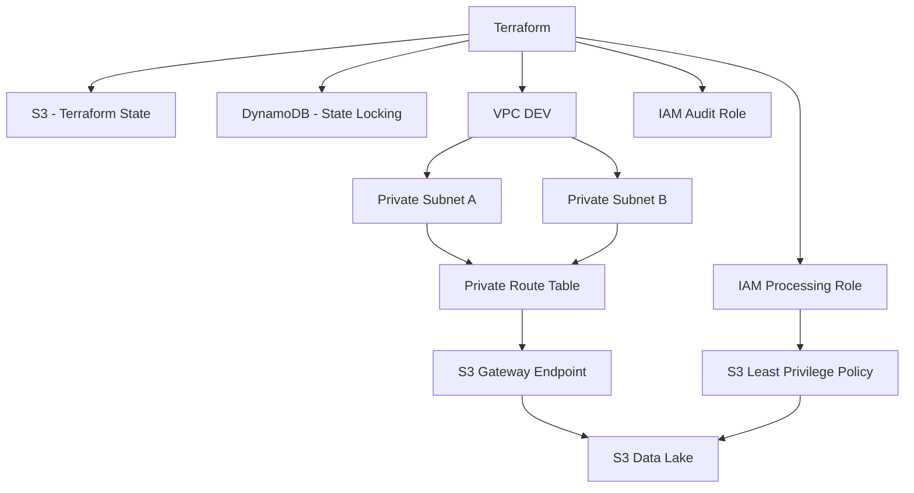
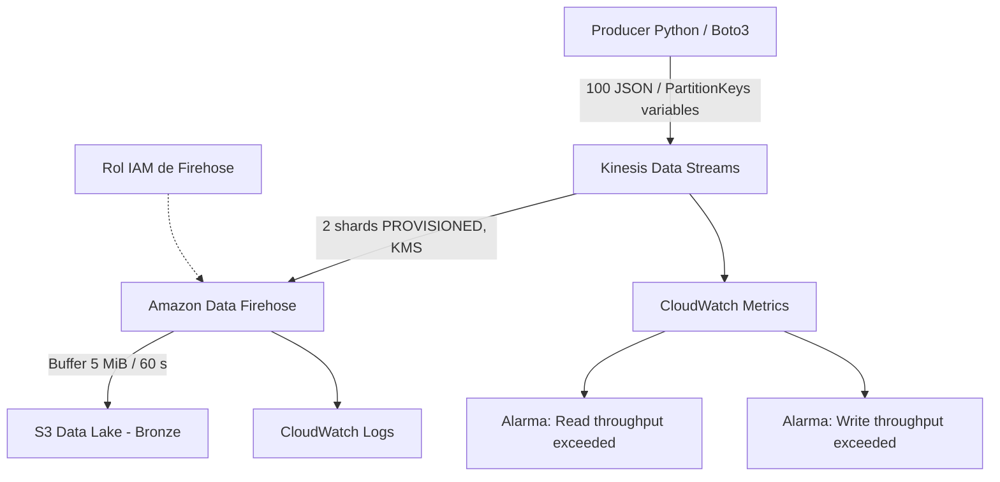
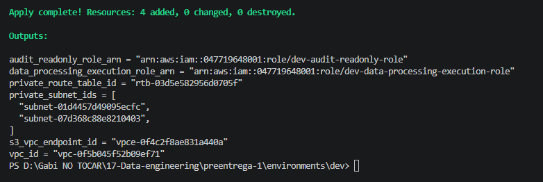
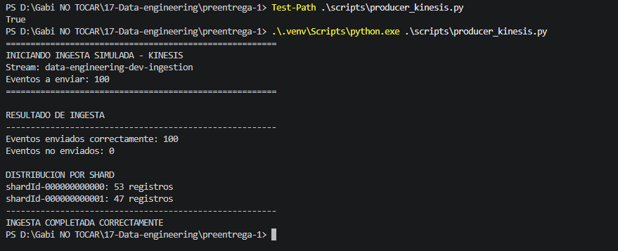
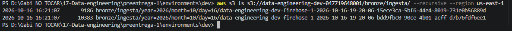
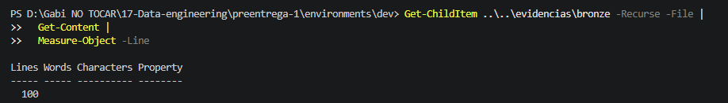
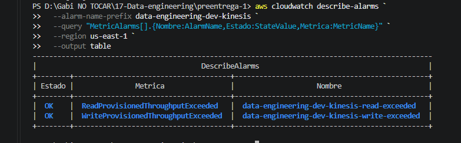
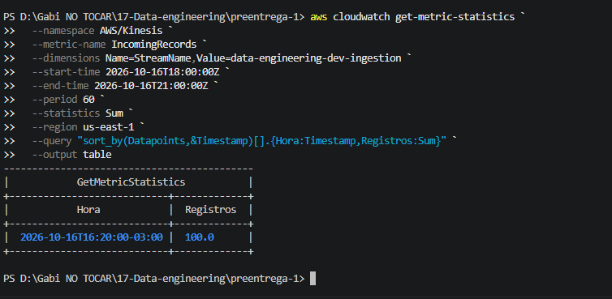

# Data Engineering en AWS — Infraestructura e ingesta real-time

Proyecto de Data Engineering desarrollado mediante **Terraform (Infrastructure as Code)** sobre AWS. Se implementó progresivamente una infraestructura base y, sobre ella, un pipeline de ingesta de eventos en tiempo casi real hacia una zona **Bronze** en Amazon S3.

| Parámetro | Valor |
|---|---|
| Entorno | `dev` |
| Región AWS | `us-east-1` |
| Infraestructura como código | Terraform (HCL) |
| Productor simulado | Python + Boto3 |
| Almacenamiento de datos crudos | Amazon S3, prefijo `bronze/` |

## Pre-entrega 1 — Infraestructura base con Terraform y AWS

### Descripción y objetivos

La primera etapa implementa una infraestructura de desarrollo modular, reproducible y reutilizable. Sus objetivos fueron:

- Configurar un **backend remoto** de Terraform en Amazon S3.
- Implementar el bloqueo del estado (*state locking*) mediante Amazon DynamoDB.
- Crear una **VPC** con dos subredes privadas distribuidas entre zonas de disponibilidad.
- Configurar una tabla de rutas privada y un **S3 Gateway Endpoint**.
- Crear un bucket S3 para los datos del proyecto, con controles de acceso, versionado y cifrado.
- Definir roles IAM de procesamiento y auditoría, junto con permisos limitados al prefijo autorizado de datos.
- Separar los componentes en módulos reutilizables e invocarlos desde `environments/dev`.

### Arquitectura base



### Organización de módulos

- `modules/network`: VPC, subredes, rutas y endpoint de S3.
- `modules/storage`: bucket S3 de datos y su configuración.
- `modules/identity`: roles IAM de procesamiento y auditoría, y políticas relacionadas.
- `environments/dev`: composición de módulos, variables, provider y backend remoto.

El backend de Terraform se administra por separado del bucket de datos del Data Lake.

---

## Pre-entrega 2 — Ingesta real-time con Kinesis y Firehose

### Objetivo

Extender el entorno `dev` para recibir eventos simulados mediante **Amazon Kinesis Data Streams**, consumirlos con **Amazon Data Firehose** y persistirlos como datos crudos en **S3 Bronze**, incorporando observabilidad mediante Amazon CloudWatch.

### Arquitectura de ingesta



El servicio Firehose entrega en **near real-time**: el intervalo de buffering es una configuración de entrega, no una garantía de latencia exacta.

### Componentes implementados

| Componente | Configuración |
|---|---|
| Kinesis Data Stream | `data-engineering-dev-ingestion`, modo `PROVISIONED`, **2 shards**, cifrado KMS y retención de 24 horas |
| Firehose Delivery Stream | `data-engineering-dev-firehose`, fuente Kinesis, destino S3 `extended_s3` |
| Buffer Firehose | **5 MiB / 60 segundos** |
| Zona Bronze | `bronze/ingesta/year=YYYY/month=MM/day=DD/` (fecha de entrega) |
| IAM | Rol y política de permisos para Firehose: lectura de Kinesis, escritura S3 y logs |
| Observabilidad | CloudWatch Logs y alarmas `ReadProvisionedThroughputExceeded` / `WriteProvisionedThroughputExceeded` |
| Productor | `scripts/producer_kinesis.py` con Boto3, eventos JSON y claves de partición UUID |

El número de shards se eligió para una carga hipotética de aproximadamente **2 MiB/s de escritura**, considerando hasta **1 MiB/s por shard** y una distribución adecuada de claves. La prueba real de 100 eventos no representa una prueba de carga de 2 MiB/s.

### Estructura relevante del repositorio

```text
modules/
  network/
  storage/
  identity/
  kinesis/
    main.tf
    variables.tf
    outputs.tf
    iam.tf
    firehose.tf
    cloudwatch.tf
    alarms.tf
environments/
  dev/
scripts/
  producer_kinesis.py
evidencias/
  preentrega-02/
requirements.txt
README.md
```

El entorno virtual `.venv/`, los planes binarios `tfplan` y los archivos crudos descargados en `evidencias/bronze/` se excluyen del control de versiones.

### Preparación y despliegue

Desde la carpeta `environments/dev`:

```powershell
terraform init
terraform fmt -recursive
terraform validate
terraform plan -out=tfplan
terraform apply tfplan
```

La infraestructura se desplegó en varias ejecuciones parciales debido a restricciones y permisos del entorno de AWS. La **última ejecución** terminó con:

```text
Apply complete! Resources: 4 added, 0 changed, 0 destroyed.
```

Este resultado corresponde únicamente a los recursos pendientes de esa última ejecución, **no** al total de recursos de la Pre-entrega 2.



### Prueba de ingesta: 100 eventos

Se preparó un entorno virtual y se instalaron las dependencias:

```powershell
python -m venv .venv
.\.venv\Scripts\python.exe -m pip install -r requirements.txt
```

Con una sesión AWS autorizada, desde la raíz del repositorio se ejecutó:

```powershell
.\.venv\Scripts\python.exe .\scripts\producer_kinesis.py
```

Cada evento contiene identificador de transacción (`transaction_id`), usuario simulado, tipo de evento, importe, moneda y timestamp UTC. La **PartitionKey** utiliza un UUID distinto por transacción, evitando una clave constante que concentraría todos los registros en un solo shard.

**Resultados observados:**

| Indicador | Valor |
|---|---:|
| Registros aceptados por Kinesis | **100** |
| Registros no enviados | **0** |
| Registros en shard 0 | **53** |
| Registros en shard 1 | **47** |

La distribución 53/47 muestra reparto entre ambos shards en esta prueba; no garantiza que no puedan existir *hot shards* con otras cargas de trabajo.



#### Evento individual mediante AWS CLI

Además del productor en Python, un registro individual se puede enviar con AWS CLI. En PowerShell, desde la raíz del repositorio:

```powershell
'{"event_type":"prueba_cli","source":"aws_cli"}' | Set-Content -Path .\evento-prueba.json -Encoding utf8
aws kinesis put-record `
  --stream-name data-engineering-dev-ingestion `
  --partition-key prueba-cli-001 `
  --data fileb://evento-prueba.json `
  --region us-east-1
```

Este es un **comando de referencia**, no una prueba adicional incluida en el conteo de 100 eventos. El archivo `evento-prueba.json` puede eliminarse después de realizarla.

### Verificación de S3 Bronze

La entrega de los registros fue verificada mediante:

```powershell
aws s3 ls s3://data-engineering-dev-047719648001/bronze/ingesta/ --recursive --region us-east-1
```

**Resultado:** Firehose generó **2 objetos** bajo `bronze/ingesta/year=2026/month=10/day=16/`, con tamaños de **9.186** y **10.383 bytes**.



Los objetos se descargaron localmente y se contaron las líneas de sus contenidos:

```powershell
Get-ChildItem .\evidencias\bronze -Recurse -File |
  Get-Content |
  Measure-Object -Line
```

**Resultado observado:** `Lines: 100`. La comparación entre el envío y el contenido persistido proporciona evidencia de una ingesta completa para esta ejecución. Este control no equivale a una validación exhaustiva de esquema o unicidad del JSON.



### Observabilidad con CloudWatch

Las dos alarmas del stream se consultaron con:

```powershell
aws cloudwatch describe-alarms `
  --alarm-name-prefix data-engineering-dev-kinesis `
  --query "MetricAlarms[].{Nombre:AlarmName,Estado:StateValue,Metrica:MetricName}" `
  --region us-east-1 `
  --output table
```

Ambas se encontraron en estado **OK**:

- `ReadProvisionedThroughputExceeded`
- `WriteProvisionedThroughputExceeded`

El estado `OK` indica que la condición de alarma no estaba activa en el momento de la consulta; no prueba la ausencia histórica de cualquier incidencia.



La métrica `IncomingRecords` del stream se consultó por intervalos de 60 segundos con estadística `Sum`:

```powershell
aws cloudwatch get-metric-statistics `
  --namespace AWS/Kinesis `
  --metric-name IncomingRecords `
  --dimensions Name=StreamName,Value=data-engineering-dev-ingestion `
  --start-time 2026-10-16T18:00:00Z `
  --end-time 2026-10-16T21:00:00Z `
  --period 60 `
  --statistics Sum `
  --region us-east-1 `
  --query "sort_by(Datapoints,&Timestamp)[].{Hora:Timestamp,Registros:Sum}" `
  --output table
```

**Resultado observado:** `IncomingRecords = 100` en el intervalo de la ejecución (16/10/2026, aproximadamente 16:20, UTC−3).



### Resultado del checkpoint

Se implementó y probó el recorrido **Python/Boto3 → Kinesis Data Streams → Firehose → S3 Bronze**. El productor confirmó **100 registros**, Kinesis/CloudWatch registró **100 IncomingRecords**, y se verificaron **100 líneas** en los dos archivos entregados a S3. También se validaron las dos alarmas requeridas.

> **Control de costos:** los shards en modo provisionado generan costos mientras permanecen activos, aun sin tráfico. Se configuró un presupuesto mensual de AWS de **USD 5** con avisos de consumo. Un presupuesto no detiene automáticamente los cargos. Los recursos de ingesta pueden retirarse selectivamente mediante un plan de Terraform revisado, preservando la infraestructura base.
