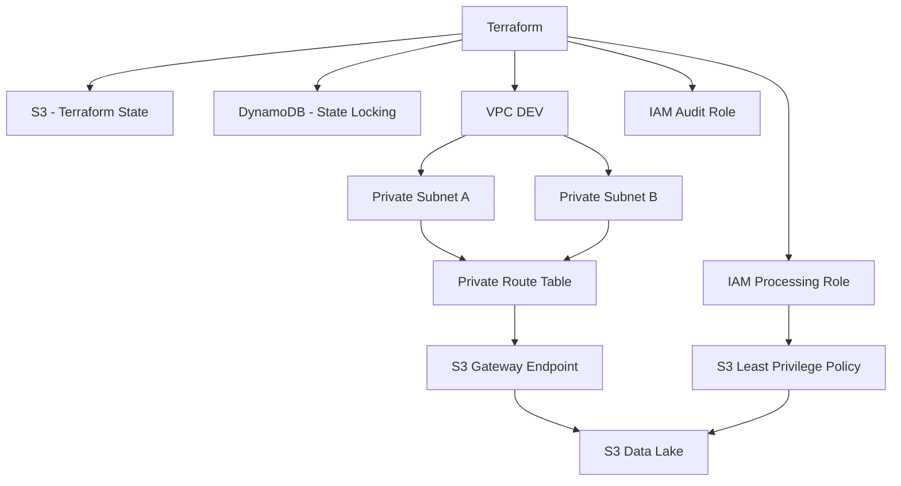
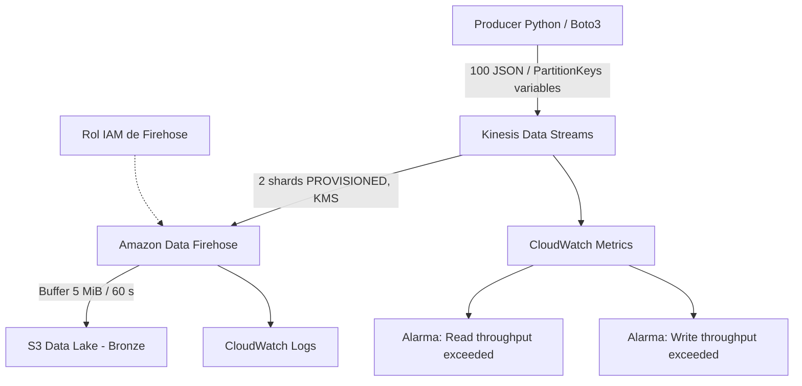
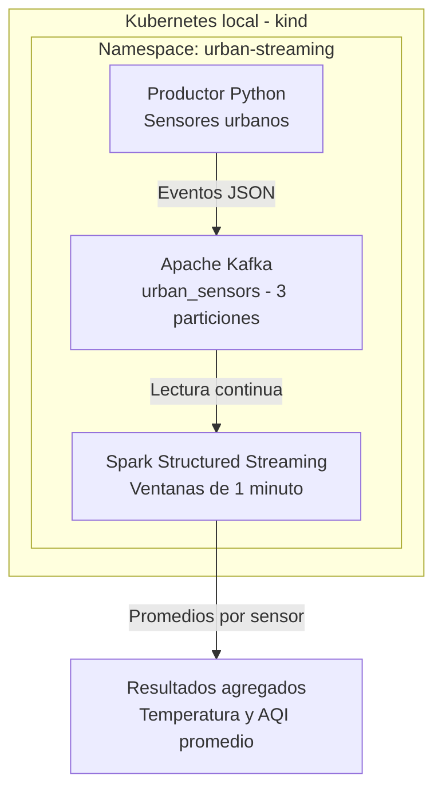
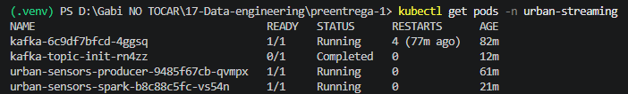
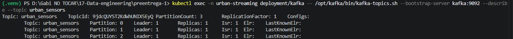
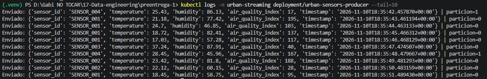
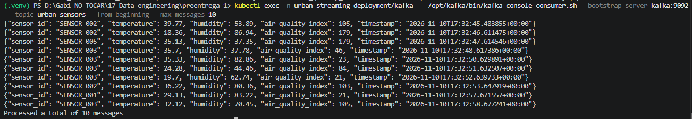
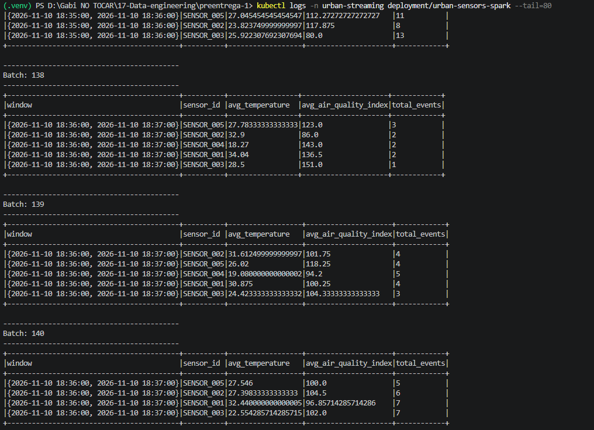
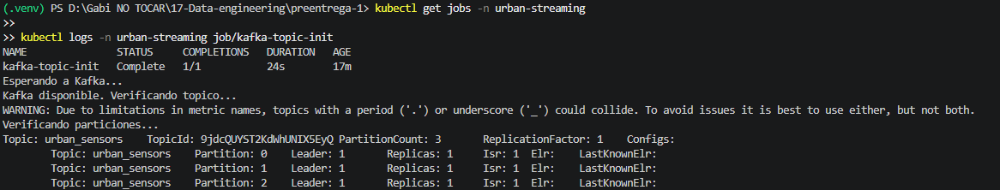

# Data Engineering en AWS — Infraestructura e ingesta real-time

Proyecto de Data Engineering desarrollado mediante **Terraform (Infrastructure as Code)** sobre AWS. Se implementó progresivamente una infraestructura base y, sobre ella, un pipeline de ingesta de eventos en tiempo casi real hacia una zona **Bronze** en Amazon S3.

| Parámetro | Valor |
|---|---|
| Entorno | `dev` |
| Región AWS | `us-east-1` |
| Infraestructura como código | Terraform (HCL) |
| Productor simulado | Python + Boto3 |
| Almacenamiento de datos crudos | Amazon S3, prefijo `bronze/` |

## Pre-entrega 1 — Infraestructura base con Terraform y AWS

### Descripción y objetivos

La primera etapa implementa una infraestructura de desarrollo modular, reproducible y reutilizable. Sus objetivos fueron:

- Configurar un **backend remoto** de Terraform en Amazon S3.
- Implementar el bloqueo del estado (*state locking*) mediante Amazon DynamoDB.
- Crear una **VPC** con dos subredes privadas distribuidas entre zonas de disponibilidad.
- Configurar una tabla de rutas privada y un **S3 Gateway Endpoint**.
- Crear un bucket S3 para los datos del proyecto, con controles de acceso, versionado y cifrado.
- Definir roles IAM de procesamiento y auditoría, junto con permisos limitados al prefijo autorizado de datos.
- Separar los componentes en módulos reutilizables e invocarlos desde `environments/dev`.

### Arquitectura base



### Organización de módulos

- `modules/network`: VPC, subredes, rutas y endpoint de S3.
- `modules/storage`: bucket S3 de datos y su configuración.
- `modules/identity`: roles IAM de procesamiento y auditoría, y políticas relacionadas.
- `environments/dev`: composición de módulos, variables, provider y backend remoto.

El backend de Terraform se administra por separado del bucket de datos del Data Lake.

---

## Pre-entrega 2 — Ingesta real-time con Kinesis y Firehose

### Objetivo

Extender el entorno `dev` para recibir eventos simulados mediante **Amazon Kinesis Data Streams**, consumirlos con **Amazon Data Firehose** y persistirlos como datos crudos en **S3 Bronze**, incorporando observabilidad mediante Amazon CloudWatch.

### Arquitectura de ingesta



El servicio Firehose entrega en **near real-time**: el intervalo de buffering es una configuración de entrega, no una garantía de latencia exacta.

### Componentes implementados

| Componente | Configuración |
|---|---|
| Kinesis Data Stream | `data-engineering-dev-ingestion`, modo `PROVISIONED`, **2 shards**, cifrado KMS y retención de 24 horas |
| Firehose Delivery Stream | `data-engineering-dev-firehose`, fuente Kinesis, destino S3 `extended_s3` |
| Buffer Firehose | **5 MiB / 60 segundos** |
| Zona Bronze | `bronze/ingesta/year=YYYY/month=MM/day=DD/` (fecha de entrega) |
| IAM | Rol y política de permisos para Firehose: lectura de Kinesis, escritura S3 y logs |
| Observabilidad | CloudWatch Logs y alarmas `ReadProvisionedThroughputExceeded` / `WriteProvisionedThroughputExceeded` |
| Productor | `scripts/producer_kinesis.py` con Boto3, eventos JSON y claves de partición UUID |

El número de shards se eligió para una carga hipotética de aproximadamente **2 MiB/s de escritura**, considerando hasta **1 MiB/s por shard** y una distribución adecuada de claves. La prueba real de 100 eventos no representa una prueba de carga de 2 MiB/s.

### Estructura relevante del repositorio

```text
modules/
  network/
  storage/
  identity/
  kinesis/
    main.tf
    variables.tf
    outputs.tf
    iam.tf
    firehose.tf
    cloudwatch.tf
    alarms.tf
environments/
  dev/
scripts/
  producer_kinesis.py
evidencias/
  preentrega-02/
requirements.txt
README.md
```

El entorno virtual `.venv/`, los planes binarios `tfplan` y los archivos crudos descargados en `evidencias/bronze/` se excluyen del control de versiones.

### Preparación y despliegue

Desde la carpeta `environments/dev`:

```powershell
terraform init
terraform fmt -recursive
terraform validate
terraform plan -out=tfplan
terraform apply tfplan
```

La infraestructura se desplegó en varias ejecuciones parciales debido a restricciones y permisos del entorno de AWS. La **última ejecución** terminó con:

```text
Apply complete! Resources: 4 added, 0 changed, 0 destroyed.
```

Este resultado corresponde únicamente a los recursos pendientes de esa última ejecución, **no** al total de recursos de la Pre-entrega 2.


### Prueba de ingesta: 100 eventos

Se preparó un entorno virtual y se instalaron las dependencias:

```powershell
python -m venv .venv
.\.venv\Scripts\python.exe -m pip install -r requirements.txt
```

Con una sesión AWS autorizada, desde la raíz del repositorio se ejecutó:

```powershell
.\.venv\Scripts\python.exe .\scripts\producer_kinesis.py
```

Cada evento contiene identificador de transacción (`transaction_id`), usuario simulado, tipo de evento, importe, moneda y timestamp UTC. La **PartitionKey** utiliza un UUID distinto por transacción, evitando una clave constante que concentraría todos los registros en un solo shard.

**Resultados observados:**

| Indicador | Valor |
|---|---:|
| Registros aceptados por Kinesis | **100** |
| Registros no enviados | **0** |
| Registros en shard 0 | **53** |
| Registros en shard 1 | **47** |

La distribución 53/47 muestra reparto entre ambos shards en esta prueba; no garantiza que no puedan existir *hot shards* con otras cargas de trabajo.


#### Evento individual mediante AWS CLI

Además del productor en Python, un registro individual se puede enviar con AWS CLI. En PowerShell, desde la raíz del repositorio:

```powershell
'{"event_type":"prueba_cli","source":"aws_cli"}' | Set-Content -Path .\evento-prueba.json -Encoding utf8
aws kinesis put-record `
  --stream-name data-engineering-dev-ingestion `
  --partition-key prueba-cli-001 `
  --data fileb://evento-prueba.json `
  --region us-east-1
```

Este es un **comando de referencia**, no una prueba adicional incluida en el conteo de 100 eventos. El archivo `evento-prueba.json` puede eliminarse después de realizarla.

### Verificación de S3 Bronze

La entrega de los registros fue verificada mediante:

```powershell
aws s3 ls s3://data-engineering-dev-047719648001/bronze/ingesta/ --recursive --region us-east-1
```

**Resultado:** Firehose generó **2 objetos** bajo `bronze/ingesta/year=2026/month=10/day=16/`, con tamaños de **9.186** y **10.383 bytes**.


Los objetos se descargaron localmente y se contaron las líneas de sus contenidos:

```powershell
Get-ChildItem .\evidencias\bronze -Recurse -File |
  Get-Content |
  Measure-Object -Line
```

**Resultado observado:** `Lines: 100`. La comparación entre el envío y el contenido persistido proporciona evidencia de una ingesta completa para esta ejecución. Este control no equivale a una validación exhaustiva de esquema o unicidad del JSON.


### Observabilidad con CloudWatch

Las dos alarmas del stream se consultaron con:

```powershell
aws cloudwatch describe-alarms `
  --alarm-name-prefix data-engineering-dev-kinesis `
  --query "MetricAlarms[].{Nombre:AlarmName,Estado:StateValue,Metrica:MetricName}" `
  --region us-east-1 `
  --output table
```

Ambas se encontraron en estado **OK**:

- `ReadProvisionedThroughputExceeded`
- `WriteProvisionedThroughputExceeded`

El estado `OK` indica que la condición de alarma no estaba activa en el momento de la consulta; no prueba la ausencia histórica de cualquier incidencia.


La métrica `IncomingRecords` del stream se consultó por intervalos de 60 segundos con estadística `Sum`:

```powershell
aws cloudwatch get-metric-statistics `
  --namespace AWS/Kinesis `
  --metric-name IncomingRecords `
  --dimensions Name=StreamName,Value=data-engineering-dev-ingestion `
  --start-time 2026-10-16T18:00:00Z `
  --end-time 2026-10-16T21:00:00Z `
  --period 60 `
  --statistics Sum `
  --region us-east-1 `
  --query "sort_by(Datapoints,&Timestamp)[].{Hora:Timestamp,Registros:Sum}" `
  --output table
```

**Resultado observado:** `IncomingRecords = 100` en el intervalo de la ejecución (16/10/2026, aproximadamente 16:20, UTC−3).


### Resultado del checkpoint

Se implementó y probó el recorrido **Python/Boto3 → Kinesis Data Streams → Firehose → S3 Bronze**. El productor confirmó **100 registros**, Kinesis/CloudWatch registró **100 IncomingRecords**, y se verificaron **100 líneas** en los dos archivos entregados a S3. También se validaron las dos alarmas requeridas.

> **Control de costos:** los shards en modo provisionado generan costos mientras permanecen activos, aun sin tráfico. Se configuró un presupuesto mensual de AWS de **USD 5** con avisos de consumo. Un presupuesto no detiene automáticamente los cargos. Los recursos de ingesta pueden retirarse selectivamente mediante un plan de Terraform revisado, preservando la infraestructura base.

---

## Pre-entrega 3 — Procesamiento distribuido con Kubernetes, Kafka y Spark

### Objetivo

Implementar una plataforma de procesamiento de eventos de sensores urbanos utilizando **Kubernetes, Apache Kafka y Apache Spark Structured Streaming**.

La solución simula mediciones de sensores, las publica en un tópico Kafka con tres particiones y las procesa continuamente mediante ventanas de un minuto para obtener promedios de temperatura y calidad del aire por sensor.

Esta etapa utiliza un entorno local con Docker Desktop y kind, sin desplegar nuevos recursos en AWS. Constituye un pipeline independiente de la arquitectura Kinesis → Firehose → S3 Bronze implementada en la Pre-entrega 02.

### Arquitectura



### Componentes implementados

| Componente | Configuración |
|---|---|
| Kubernetes | Clúster local `urban-data` mediante kind |
| Namespace | `urban-streaming` |
| Apache Kafka | Versión 3.9.1, KRaft, un broker |
| Tópico Kafka | `urban_sensors`, tres particiones y factor de replicación 1 |
| Productor | Python 3.13, generación continua de eventos JSON |
| Apache Spark | Versión 3.5.7, Structured Streaming |
| Procesamiento | Ventanas de un minuto agrupadas por `sensor_id` |
| ConfigMaps | Configuración externa de Kafka y Spark |
| Kubernetes Job | Inicialización automatizada del tópico |

Spark se ejecuta en modo local con dos hilos dentro de un pod Kubernetes. Esta configuración permite demostrar el procesamiento paralelo y continuo, aunque no representa un clúster Spark multinodo.


### Requisitos previos

La implementación fue desarrollada y validada en Windows 11 utilizando PowerShell.

Herramientas utilizadas:

| Herramienta | Versión utilizada |
|---|---|
| Docker Desktop | 4.99.0 |
| Docker Engine | 29.9.3 |
| kind | 0.33.0 |
| Kubernetes | 1.35.0 |
| kubectl | 1.36.1 |
| Python | 3.13.7 |
| Git | 2.49.0 |

Se requiere Docker Desktop funcionando con el backend WSL 2, acceso a Internet para descargar las imágenes y dependencias, y recursos suficientes para ejecutar Kafka y Spark simultáneamente.

El laboratorio fue validado en un equipo con aproximadamente 20 GB de RAM y 6 procesadores lógicos.

### Estructura de archivos

Los componentes de esta entrega se organizan de la siguiente manera:

```text
k8s/
├── namespace.yaml
├── kafka-configmap.yaml
├── kafka-deployment.yaml
├── kafka-service.yaml
├── kafka-topic-job.yaml
├── producer-deployment.yaml
├── spark-configmap.yaml
└── spark-deployment.yaml

producer/
├── Dockerfile
├── requirements.txt
└── producer.py

spark/
├── Dockerfile
└── streaming_job.py

evidencias/
└── preentrega-03/
```

Los manifiestos Kubernetes, scripts y Dockerfiles están versionados directamente en el repositorio. No se incluyen imágenes Docker exportadas, entornos virtuales ni archivos temporales de Python.

### Despliegue del entorno

Los siguientes comandos deben ejecutarse desde PowerShell, ubicado en la raíz del repositorio.

#### 1. Crear el clúster Kubernetes

Con Docker Desktop en ejecución, descargar e instalar kind si todavía no está disponible.

Crear el clúster local:

```powershell
kind create cluster --name urban-data --image kindest/node:v1.35.0 --wait 120s
```

Si kind no está incorporado al PATH y se instaló en la carpeta de herramientas del usuario, ejecutar:

```powershell
& "$HOME\tools\kind.exe" create cluster --name urban-data --image kindest/node:v1.35.0 --wait 120s
```

Verificar que Kubernetes esté disponible:

```powershell
kubectl config current-context
kubectl get nodes
```

El contexto esperado es `kind-urban-data` y el nodo debe encontrarse en estado `Ready`.

#### 2. Construir las imágenes Docker

Construir la imagen del productor Python:

```powershell
docker build -t urban-sensors-producer:1.0 -f producer/Dockerfile producer
```

Construir la imagen de Spark:

```powershell
docker build -t urban-sensors-spark:1.0 -f spark/Dockerfile spark
```

Las imágenes se construyen localmente y no necesitan publicarse en Docker Hub.

La imagen de Spark se basa en Apache Spark 3.5.7 y utiliza el conector Kafka compatible con Spark y Scala 2.12.

#### 3. Cargar las imágenes en kind

```powershell
kind load docker-image urban-sensors-producer:1.0 --name urban-data

kind load docker-image urban-sensors-spark:1.0 --name urban-data
```

Si kind no está disponible en el PATH, reemplazar `kind` por `& "$HOME\tools\kind.exe"`.

Las imágenes se cargan directamente en el nodo de Kubernetes para que los Deployments puedan utilizarlas sin descargarlas desde un registro externo.


#### 4. Crear el namespace y configurar Kafka

Aplicar el namespace dedicado:

```powershell
kubectl apply -f k8s/namespace.yaml
```

Aplicar el ConfigMap y el Service de Kafka:

```powershell
kubectl apply -f k8s/kafka-configmap.yaml
kubectl apply -f k8s/kafka-service.yaml
```

Desplegar el broker Kafka:

```powershell
kubectl apply -f k8s/kafka-deployment.yaml
```

Esperar a que Kubernetes confirme que el broker está listo:

```powershell
kubectl rollout status deployment/kafka -n urban-streaming --timeout=180s
```

Verificar su estado:

```powershell
kubectl get pods -n urban-streaming
kubectl get svc -n urban-streaming
```

Kafka utiliza KRaft con un broker/controlador y el Service interno `kafka:9092`.

El Service incluye `publishNotReadyAddresses: true` para permitir la comunicación del controlador KRaft durante el arranque del broker.

#### 5. Crear el tópico Kafka

Aplicar el Job de inicialización:

```powershell
kubectl apply -f k8s/kafka-topic-job.yaml
```

Verificar que termine correctamente:

```powershell
kubectl wait --for=condition=complete job/kafka-topic-init -n urban-streaming --timeout=180s
```

Consultar sus logs:

```powershell
kubectl logs -n urban-streaming job/kafka-topic-init
```

El Job crea el tópico `urban_sensors` si no existe, utilizando tres particiones y un factor de replicación de uno.

Si el tópico ya existe, consulta su configuración. No modifica automáticamente el número de particiones de un tópico existente.

#### 6. Desplegar el productor Python

```powershell
kubectl apply -f k8s/producer-deployment.yaml
```

Verificar el Deployment:

```powershell
kubectl rollout status deployment/urban-sensors-producer -n urban-streaming --timeout=180s
```

Consultar los eventos generados:

```powershell
kubectl logs -n urban-streaming deployment/urban-sensors-producer --tail=10
```

El productor simula cinco sensores urbanos y publica aproximadamente un evento JSON por segundo.

Cada evento contiene:

- `sensor_id`
- `temperature`
- `humidity`
- `air_quality_index`
- `timestamp`

El identificador del sensor se utiliza como clave de Kafka para mantener el orden de sus eventos dentro de una misma partición.

#### 7. Desplegar Spark Structured Streaming

Aplicar la configuración:

```powershell
kubectl apply -f k8s/spark-configmap.yaml
```

Desplegar Spark:

```powershell
kubectl apply -f k8s/spark-deployment.yaml
```

Verificar el estado del Deployment:

```powershell
kubectl rollout status deployment/urban-sensors-spark -n urban-streaming --timeout=300s
```

Consultar los resultados del procesamiento:

```powershell
kubectl logs -n urban-streaming deployment/urban-sensors-spark --tail=80
```

Spark lee continuamente los eventos desde Kafka y realiza agregaciones por `sensor_id` en ventanas de un minuto.

Se calculan:

- `avg_temperature`: temperatura promedio.
- `avg_air_quality_index`: índice promedio de calidad del aire.
- `total_events`: cantidad de eventos agrupados.

El procesamiento utiliza microbatches de 10 segundos, modo de salida `update` y un watermark de dos minutos para gestionar eventos retrasados.

El conector Kafka se descarga mediante `spark-submit --packages` durante el inicio de Spark.

#### 8. Verificar la plataforma completa

```powershell
kubectl get pods -n urban-streaming
kubectl get jobs -n urban-streaming
```

El resultado esperado es:

- Kafka: `1/1 Running`.
- Productor Python: `1/1 Running`.
- Spark: `1/1 Running`.
- Job `kafka-topic-init`: `Complete 1/1`.

También es posible comprobar la lectura directa de eventos desde Kafka:

```powershell
kubectl exec -n urban-streaming deployment/kafka -- /opt/kafka/bin/kafka-console-consumer.sh --bootstrap-server kafka:9092 --topic urban_sensors --from-beginning --max-messages 10
```

Esta prueba permite recuperar diez mensajes JSON almacenados en el tópico y confirmar el funcionamiento del flujo de ingesta.


### Validaciones y evidencias

La plataforma se desplegó y validó exitosamente el 10 de noviembre de 2026 en un clúster Kubernetes local.

#### 1. Estado de los componentes

Se verificaron los tres pods principales en estado `1/1 Running`:

- Apache Kafka.
- Productor Python.
- Apache Spark Structured Streaming.



#### 2. Tópico Kafka

Se comprobó que el tópico `urban_sensors` cuenta con:

- Tres particiones: 0, 1 y 2.
- Factor de replicación 1.
- Broker 1 como líder de las tres particiones.



#### 3. Envío de eventos desde Python

El productor generó eventos JSON con los cinco campos solicitados y confirmó su publicación en Kafka.

Los registros del productor muestran el sensor, las mediciones, el timestamp y la partición asignada.



#### 4. Lectura de eventos desde Kafka

Se utilizó el consumidor de consola de Kafka para recuperar diez eventos desde `urban_sensors`.

La prueba finalizó con el mensaje:

`Processed a total of 10 messages`



#### 5. Procesamiento con Spark Structured Streaming

Spark leyó los eventos JSON desde Kafka y calculó agregaciones por `sensor_id` utilizando ventanas temporales de un minuto.

Se observaron resultados reales con las columnas:

- `window`
- `sensor_id`
- `avg_temperature`
- `avg_air_quality_index`
- `total_events`

Los resultados se actualizaron entre distintos microbatches, demostrando el procesamiento continuo de los eventos.



#### 6. Inicialización automática del tópico

El Job `kafka-topic-init` se ejecutó exitosamente y finalizó con:

`Complete 1/1`

Sus logs confirmaron la conexión con Kafka y la existencia del tópico `urban_sensors` con tres particiones.



### Consideraciones técnicas y limitaciones

Esta implementación está orientada al aprendizaje y a la validación funcional del procesamiento de eventos.

- **Kubernetes local:** el clúster se ejecuta mediante kind sobre Docker Desktop, con un único nodo.
- **Kafka:** utiliza un broker/controlador KRaft. Las tres particiones permiten particionamiento lógico, pero no proporcionan alta disponibilidad.
- **Spark:** se ejecuta en modo `local[2]` dentro de un pod Kubernetes. No se implementa un clúster Spark multinodo.
- **Almacenamiento:** Kafka y los checkpoints de Spark utilizan almacenamiento temporal. La recreación de los pods puede ocasionar pérdida de datos o estado.
- **Seguridad:** los contenedores de aplicación se ejecutan con restricciones de privilegios. Kafka utiliza comunicación PLAINTEXT dentro del laboratorio local, por lo que esta configuración no debe exponerse directamente a redes públicas.
- **Conector Kafka:** Spark obtiene sus dependencias mediante Maven Central durante el inicio y necesita conectividad para descargarlas.
- **Costos:** no se desplegaron servicios AWS adicionales para esta etapa. El procesamiento utiliza recursos de la computadora local.

### Limpieza del entorno local

Para detener el productor sin eliminar su definición:

```powershell
kubectl scale deployment urban-sensors-producer --replicas=0 -n urban-streaming
```

Para restaurarlo posteriormente:

```powershell
kubectl scale deployment urban-sensors-producer --replicas=1 -n urban-streaming
```

Para eliminar completamente el clúster local y sus recursos:

```powershell
kind delete cluster --name urban-data
```

Si kind está instalado en la carpeta local de herramientas del usuario:

```powershell
& "$HOME\tools\kind.exe" delete cluster --name urban-data
```

**Advertencia:** eliminar el clúster destruye los recursos Kubernetes y los datos temporales asociados. No elimina los archivos del repositorio ni modifica la infraestructura AWS gestionada mediante Terraform.

### Resultado de la Pre-entrega 03

Se implementó y validó un pipeline funcional de eventos urbanos:

**Productor Python → Apache Kafka → Apache Spark Structured Streaming**

La solución recibe mediciones simuladas, las distribuye mediante un tópico de Kafka con tres particiones y calcula promedios de temperatura y calidad del aire por sensor en ventanas de un minuto.

Los manifiestos Kubernetes, Dockerfiles y scripts permiten reconstruir el entorno local siguiendo los pasos documentados.
