# Data Engineering — Infraestructura, streaming y Lakehouse

Proyecto de Data Engineering desarrollado progresivamente mediante **Terraform (Infrastructure as Code)** sobre AWS y laboratorios locales con Kubernetes y Docker Compose. Incluye infraestructura base, ingesta de eventos hacia **S3 Bronze**, procesamiento streaming con **Apache Flink** y una capa analítica **Lakehouse con Apache Iceberg, S3, JdbcCatalog sobre PostgreSQL y AWS Glue Data Catalog**. Cada pre-entrega describe su alcance, validación y limitaciones.

| Parámetro | Valor |
|---|---|
| Entorno | `dev` (AWS) y laboratorio local |
| Región AWS | `us-east-1` |
| Infraestructura como código | Terraform (HCL) |
| Productor simulado | Python + Boto3 |
| Almacenamiento de datos crudos | Amazon S3, prefijo `bronze/` |
| Almacenamiento analítico | Apache Iceberg sobre S3 (AWS Glue) y S3 LocalStack (JdbcCatalog sobre PostgreSQL) |
| Procesamiento streaming | Apache Flink (Java / PyFlink); laboratorio alternativo Kafka + Spark en Kubernetes |

## Pre-entrega 1 — Infraestructura base con Terraform y AWS

### Descripción y objetivos

La primera etapa implementa una infraestructura de desarrollo modular, reproducible y reutilizable. Sus objetivos fueron:

- Configurar un **backend remoto** de Terraform en Amazon S3.
- Implementar el bloqueo del estado (*state locking*) mediante Amazon DynamoDB.
- Crear una **VPC** con dos subredes privadas distribuidas entre zonas de disponibilidad.
- Configurar una tabla de rutas privada y un **S3 Gateway Endpoint**.
- Crear un bucket S3 para los datos del proyecto, con controles de acceso, versionado y cifrado.
- Definir roles IAM de procesamiento y auditoría, junto con permisos limitados al prefijo autorizado de datos.
- Separar los componentes en módulos reutilizables e invocarlos desde `environments/dev`.

### Arquitectura base

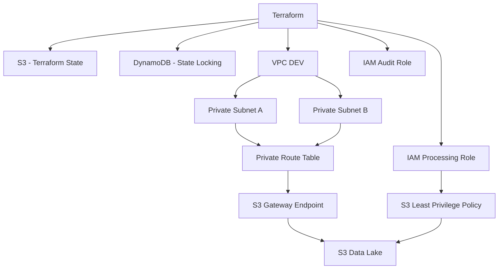

### Organización de módulos

- `modules/network`: VPC, subredes, rutas y endpoint de S3.
- `modules/storage`: bucket S3 de datos y su configuración.
- `modules/identity`: roles IAM de procesamiento y auditoría, y políticas relacionadas.
- `environments/dev`: composición de módulos, variables, provider y backend remoto.

El backend de Terraform se administra por separado del bucket de datos del Data Lake.

---

## Pre-entrega 2 — Ingesta real-time con Kinesis y Firehose

### Objetivo

Extender el entorno `dev` para recibir eventos simulados mediante **Amazon Kinesis Data Streams**, consumirlos con **Amazon Data Firehose** y persistirlos como datos crudos en **S3 Bronze**, incorporando observabilidad mediante Amazon CloudWatch.

### Arquitectura de ingesta

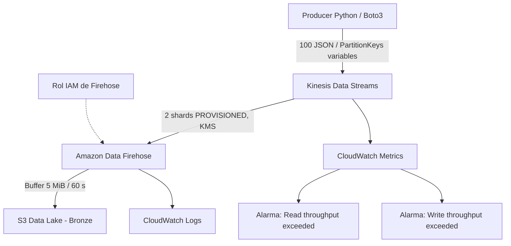

El servicio Firehose entrega en **near real-time**: el intervalo de buffering es una configuración de entrega, no una garantía de latencia exacta.

### Componentes implementados

| Componente | Configuración |
|---|---|
| Kinesis Data Stream | `data-engineering-dev-ingestion`, modo `PROVISIONED`, **2 shards**, cifrado KMS y retención de 24 horas |
| Firehose Delivery Stream | `data-engineering-dev-firehose`, fuente Kinesis, destino S3 `extended_s3` |
| Buffer Firehose | **5 MiB / 60 segundos** |
| Zona Bronze | `bronze/ingesta/year=YYYY/month=MM/day=DD/` (fecha de entrega) |
| IAM | Rol y política de permisos para Firehose: lectura de Kinesis, escritura S3 y logs |
| Observabilidad | CloudWatch Logs y alarmas `ReadProvisionedThroughputExceeded` / `WriteProvisionedThroughputExceeded` |
| Productor | `scripts/producer_kinesis.py` con Boto3, eventos JSON y claves de partición UUID |

El número de shards se eligió para una carga hipotética de aproximadamente **2 MiB/s de escritura**, considerando hasta **1 MiB/s por shard** y una distribución adecuada de claves. La prueba real de 100 eventos no representa una prueba de carga de 2 MiB/s.

### Estructura relevante del repositorio

```text
modules/
  network/
  storage/
  identity/
  kinesis/
    main.tf
    variables.tf
    outputs.tf
    iam.tf
    firehose.tf
    cloudwatch.tf
    alarms.tf
environments/
  dev/
scripts/
  producer_kinesis.py
evidencias/
  preentrega-02/
requirements.txt
README.md
```

El entorno virtual `.venv/`, los planes binarios `tfplan` y los archivos crudos descargados en `evidencias/bronze/` se excluyen del control de versiones.

### Preparación y despliegue

Desde la carpeta `environments/dev`:

```powershell
terraform init
terraform fmt -recursive
terraform validate
terraform plan -out=tfplan
terraform apply tfplan
```

La infraestructura se desplegó en varias ejecuciones parciales debido a restricciones y permisos del entorno de AWS. La **última ejecución** terminó con:

```text
Apply complete! Resources: 4 added, 0 changed, 0 destroyed.
```

Este resultado corresponde únicamente a los recursos pendientes de esa última ejecución, **no** al total de recursos de la Pre-entrega 2.

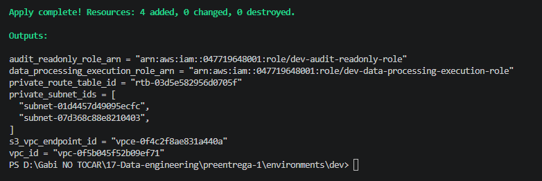

### Prueba de ingesta: 100 eventos

Se preparó un entorno virtual y se instalaron las dependencias:

```powershell
python -m venv .venv
.\.venv\Scripts\python.exe -m pip install -r requirements.txt
```

Con una sesión AWS autorizada, desde la raíz del repositorio se ejecutó:

```powershell
.\.venv\Scripts\python.exe .\scripts\producer_kinesis.py
```

Cada evento contiene identificador de transacción (`transaction_id`), usuario simulado, tipo de evento, importe, moneda y timestamp UTC. La **PartitionKey** utiliza un UUID distinto por transacción, evitando una clave constante que concentraría todos los registros en un solo shard.

**Resultados observados:**

| Indicador | Valor |
|---|---:|
| Registros aceptados por Kinesis | **100** |
| Registros no enviados | **0** |
| Registros en shard 0 | **53** |
| Registros en shard 1 | **47** |

La distribución 53/47 muestra reparto entre ambos shards en esta prueba; no garantiza que no puedan existir *hot shards* con otras cargas de trabajo.

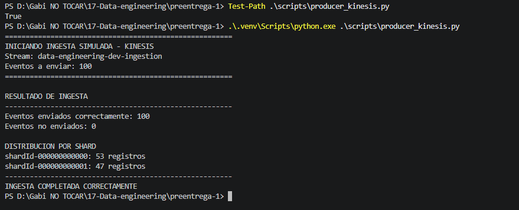

#### Evento individual mediante AWS CLI

Además del productor en Python, un registro individual se puede enviar con AWS CLI. En PowerShell, desde la raíz del repositorio:

```powershell
'{"event_type":"prueba_cli","source":"aws_cli"}' | Set-Content -Path .\evento-prueba.json -Encoding utf8
aws kinesis put-record `
  --stream-name data-engineering-dev-ingestion `
  --partition-key prueba-cli-001 `
  --data fileb://evento-prueba.json `
  --region us-east-1
```

Este es un **comando de referencia**, no una prueba adicional incluida en el conteo de 100 eventos. El archivo `evento-prueba.json` puede eliminarse después de realizarla.

### Verificación de S3 Bronze

La entrega de los registros fue verificada mediante:

```powershell
aws s3 ls s3://data-engineering-dev-047719648001/bronze/ingesta/ --recursive --region us-east-1
```

**Resultado:** Firehose generó **2 objetos** bajo `bronze/ingesta/year=2026/month=10/day=16/`, con tamaños de **9.186** y **10.383 bytes**.

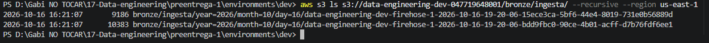

Los objetos se descargaron localmente y se contaron las líneas de sus contenidos:

```powershell
Get-ChildItem .\evidencias\bronze -Recurse -File |
  Get-Content |
  Measure-Object -Line
```

**Resultado observado:** `Lines: 100`. La comparación entre el envío y el contenido persistido proporciona evidencia de una ingesta completa para esta ejecución. Este control no equivale a una validación exhaustiva de esquema o unicidad del JSON.

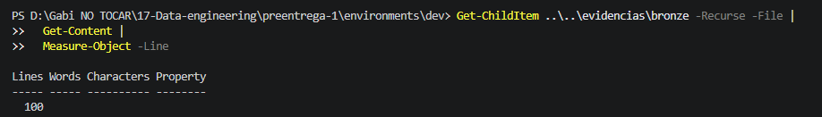

### Observabilidad con CloudWatch

Las dos alarmas del stream se consultaron con:

```powershell
aws cloudwatch describe-alarms `
  --alarm-name-prefix data-engineering-dev-kinesis `
  --query "MetricAlarms[].{Nombre:AlarmName,Estado:StateValue,Metrica:MetricName}" `
  --region us-east-1 `
  --output table
```

Ambas se encontraron en estado **OK**:

- `ReadProvisionedThroughputExceeded`
- `WriteProvisionedThroughputExceeded`

El estado `OK` indica que la condición de alarma no estaba activa en el momento de la consulta; no prueba la ausencia histórica de cualquier incidencia.

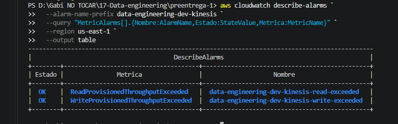

La métrica `IncomingRecords` del stream se consultó por intervalos de 60 segundos con estadística `Sum`:

```powershell
aws cloudwatch get-metric-statistics `
  --namespace AWS/Kinesis `
  --metric-name IncomingRecords `
  --dimensions Name=StreamName,Value=data-engineering-dev-ingestion `
  --start-time 2026-10-16T18:00:00Z `
  --end-time 2026-10-16T21:00:00Z `
  --period 60 `
  --statistics Sum `
  --region us-east-1 `
  --query "sort_by(Datapoints,&Timestamp)[].{Hora:Timestamp,Registros:Sum}" `
  --output table
```

**Resultado observado:** `IncomingRecords = 100` en el intervalo de la ejecución (16/10/2026, aproximadamente 16:20, UTC−3).

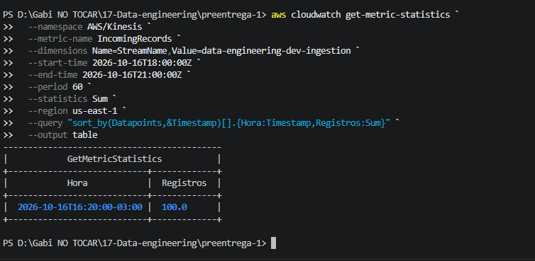

### Resultado del checkpoint

Se implementó y probó el recorrido **Python/Boto3 → Kinesis Data Streams → Firehose → S3 Bronze**. El productor confirmó **100 registros**, Kinesis/CloudWatch registró **100 IncomingRecords**, y se verificaron **100 líneas** en los dos archivos entregados a S3. También se validaron las dos alarmas requeridas.

> **Control de costos:** los shards en modo provisionado generan costos mientras permanecen activos, aun sin tráfico. Se configuró un presupuesto mensual de AWS de **USD 5** con avisos de consumo. Un presupuesto no detiene automáticamente los cargos. Los recursos de ingesta pueden retirarse selectivamente mediante un plan de Terraform revisado, preservando la infraestructura base.

---

## Pre-entrega 3 — Procesamiento distribuido con Kubernetes, Kafka y Spark

### Objetivo

Implementar una plataforma de procesamiento de eventos de sensores urbanos utilizando **Kubernetes, Apache Kafka y Apache Spark Structured Streaming**.

La solución simula mediciones de sensores, las publica en un tópico Kafka con tres particiones y las procesa continuamente mediante ventanas de un minuto para obtener promedios de temperatura y calidad del aire por sensor.

Esta etapa utiliza un entorno local con Docker Desktop y kind, sin desplegar nuevos recursos en AWS. Constituye un pipeline independiente de la arquitectura Kinesis → Firehose → S3 Bronze implementada en la Pre-entrega 02.

### Arquitectura

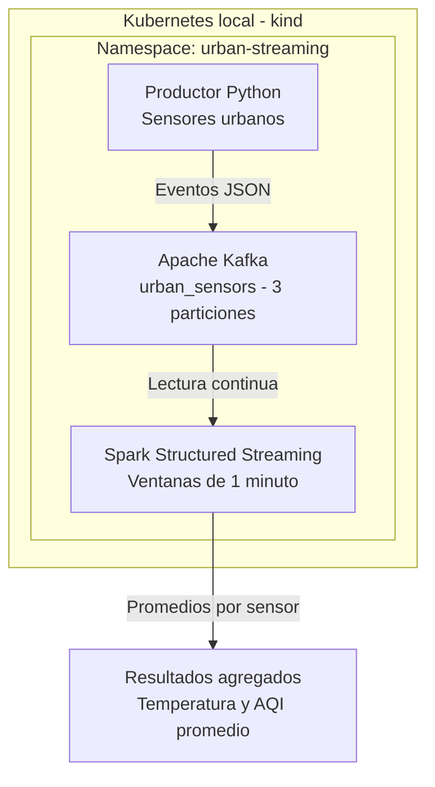

### Componentes implementados

| Componente | Configuración |
|---|---|
| Kubernetes | Clúster local `urban-data` mediante kind |
| Namespace | `urban-streaming` |
| Apache Kafka | Versión 3.9.1, KRaft, un broker |
| Tópico Kafka | `urban_sensors`, tres particiones y factor de replicación 1 |
| Productor | Python 3.13, generación continua de eventos JSON |
| Apache Spark | Versión 3.5.7, Structured Streaming |
| Procesamiento | Ventanas de un minuto agrupadas por `sensor_id` |
| ConfigMaps | Configuración externa de Kafka y Spark |
| Kubernetes Job | Inicialización automatizada del tópico |

Spark se ejecuta en modo local con dos hilos dentro de un pod Kubernetes. Esta configuración permite demostrar el procesamiento paralelo y continuo, aunque no representa un clúster Spark multinodo.


### Requisitos previos

La implementación fue desarrollada y validada en Windows 11 utilizando PowerShell.

Herramientas utilizadas:

| Herramienta | Versión utilizada |
|---|---|
| Docker Desktop | 4.99.0 |
| Docker Engine | 29.9.3 |
| kind | 0.33.0 |
| Kubernetes | 1.35.0 |
| kubectl | 1.36.1 |
| Python | 3.13.7 |
| Git | 2.49.0 |

Se requiere Docker Desktop funcionando con el backend WSL 2, acceso a Internet para descargar las imágenes y dependencias, y recursos suficientes para ejecutar Kafka y Spark simultáneamente.

El laboratorio fue validado en un equipo con aproximadamente 20 GB de RAM y 6 procesadores lógicos.

### Estructura de archivos

Los componentes de esta entrega se organizan de la siguiente manera:

```text
k8s/
├── namespace.yaml
├── kafka-configmap.yaml
├── kafka-deployment.yaml
├── kafka-service.yaml
├── kafka-topic-job.yaml
├── producer-deployment.yaml
├── spark-configmap.yaml
└── spark-deployment.yaml

producer/
├── Dockerfile
├── requirements.txt
└── producer.py

spark/
├── Dockerfile
└── streaming_job.py

evidencias/
└── preentrega-03/
```

Los manifiestos Kubernetes, scripts y Dockerfiles están versionados directamente en el repositorio. No se incluyen imágenes Docker exportadas, entornos virtuales ni archivos temporales de Python.

### Despliegue del entorno

Los siguientes comandos deben ejecutarse desde PowerShell, ubicado en la raíz del repositorio.

#### 1. Crear el clúster Kubernetes

Con Docker Desktop en ejecución, descargar e instalar kind si todavía no está disponible.

Crear el clúster local:

```powershell
kind create cluster --name urban-data --image kindest/node:v1.35.0 --wait 120s
```

Si kind no está incorporado al PATH y se instaló en la carpeta de herramientas del usuario, ejecutar:

```powershell
& "$HOME\tools\kind.exe" create cluster --name urban-data --image kindest/node:v1.35.0 --wait 120s
```

Verificar que Kubernetes esté disponible:

```powershell
kubectl config current-context
kubectl get nodes
```

El contexto esperado es `kind-urban-data` y el nodo debe encontrarse en estado `Ready`.

#### 2. Construir las imágenes Docker

Construir la imagen del productor Python:

```powershell
docker build -t urban-sensors-producer:1.0 -f producer/Dockerfile producer
```

Construir la imagen de Spark:

```powershell
docker build -t urban-sensors-spark:1.0 -f spark/Dockerfile spark
```

Las imágenes se construyen localmente y no necesitan publicarse en Docker Hub.

La imagen de Spark se basa en Apache Spark 3.5.7 y utiliza el conector Kafka compatible con Spark y Scala 2.12.

#### 3. Cargar las imágenes en kind

```powershell
kind load docker-image urban-sensors-producer:1.0 --name urban-data

kind load docker-image urban-sensors-spark:1.0 --name urban-data
```

Si kind no está disponible en el PATH, reemplazar `kind` por `& "$HOME\tools\kind.exe"`.

Las imágenes se cargan directamente en el nodo de Kubernetes para que los Deployments puedan utilizarlas sin descargarlas desde un registro externo.


#### 4. Crear el namespace y configurar Kafka

Aplicar el namespace dedicado:

```powershell
kubectl apply -f k8s/namespace.yaml
```

Aplicar el ConfigMap y el Service de Kafka:

```powershell
kubectl apply -f k8s/kafka-configmap.yaml
kubectl apply -f k8s/kafka-service.yaml
```

Desplegar el broker Kafka:

```powershell
kubectl apply -f k8s/kafka-deployment.yaml
```

Esperar a que Kubernetes confirme que el broker está listo:

```powershell
kubectl rollout status deployment/kafka -n urban-streaming --timeout=180s
```

Verificar su estado:

```powershell
kubectl get pods -n urban-streaming
kubectl get svc -n urban-streaming
```

Kafka utiliza KRaft con un broker/controlador y el Service interno `kafka:9092`.

El Service incluye `publishNotReadyAddresses: true` para permitir la comunicación del controlador KRaft durante el arranque del broker.

#### 5. Crear el tópico Kafka

Aplicar el Job de inicialización:

```powershell
kubectl apply -f k8s/kafka-topic-job.yaml
```

Verificar que termine correctamente:

```powershell
kubectl wait --for=condition=complete job/kafka-topic-init -n urban-streaming --timeout=180s
```

Consultar sus logs:

```powershell
kubectl logs -n urban-streaming job/kafka-topic-init
```

El Job crea el tópico `urban_sensors` si no existe, utilizando tres particiones y un factor de replicación de uno.

Si el tópico ya existe, consulta su configuración. No modifica automáticamente el número de particiones de un tópico existente.

#### 6. Desplegar el productor Python

```powershell
kubectl apply -f k8s/producer-deployment.yaml
```

Verificar el Deployment:

```powershell
kubectl rollout status deployment/urban-sensors-producer -n urban-streaming --timeout=180s
```

Consultar los eventos generados:

```powershell
kubectl logs -n urban-streaming deployment/urban-sensors-producer --tail=10
```

El productor simula cinco sensores urbanos y publica aproximadamente un evento JSON por segundo.

Cada evento contiene:

- `sensor_id`
- `temperature`
- `humidity`
- `air_quality_index`
- `timestamp`

El identificador del sensor se utiliza como clave de Kafka para mantener el orden de sus eventos dentro de una misma partición.

#### 7. Desplegar Spark Structured Streaming

Aplicar la configuración:

```powershell
kubectl apply -f k8s/spark-configmap.yaml
```

Desplegar Spark:

```powershell
kubectl apply -f k8s/spark-deployment.yaml
```

Verificar el estado del Deployment:

```powershell
kubectl rollout status deployment/urban-sensors-spark -n urban-streaming --timeout=300s
```

Consultar los resultados del procesamiento:

```powershell
kubectl logs -n urban-streaming deployment/urban-sensors-spark --tail=80
```

Spark lee continuamente los eventos desde Kafka y realiza agregaciones por `sensor_id` en ventanas de un minuto.

Se calculan:

- `avg_temperature`: temperatura promedio.
- `avg_air_quality_index`: índice promedio de calidad del aire.
- `total_events`: cantidad de eventos agrupados.

El procesamiento utiliza microbatches de 10 segundos, modo de salida `update` y un watermark de dos minutos para gestionar eventos retrasados.

El conector Kafka se descarga mediante `spark-submit --packages` durante el inicio de Spark.

#### 8. Verificar la plataforma completa

```powershell
kubectl get pods -n urban-streaming
kubectl get jobs -n urban-streaming
```

El resultado esperado es:

- Kafka: `1/1 Running`.
- Productor Python: `1/1 Running`.
- Spark: `1/1 Running`.
- Job `kafka-topic-init`: `Complete 1/1`.

También es posible comprobar la lectura directa de eventos desde Kafka:

```powershell
kubectl exec -n urban-streaming deployment/kafka -- /opt/kafka/bin/kafka-console-consumer.sh --bootstrap-server kafka:9092 --topic urban_sensors --from-beginning --max-messages 10
```

Esta prueba permite recuperar diez mensajes JSON almacenados en el tópico y confirmar el funcionamiento del flujo de ingesta.


### Validaciones y evidencias

La plataforma se desplegó y validó exitosamente el 10 de noviembre de 2026 en un clúster Kubernetes local.

#### 1. Estado de los componentes

Se verificaron los tres pods principales en estado `1/1 Running`:

- Apache Kafka.
- Productor Python.
- Apache Spark Structured Streaming.

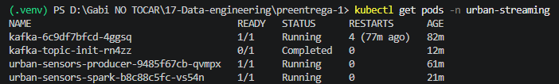

#### 2. Tópico Kafka

Se comprobó que el tópico `urban_sensors` cuenta con:

- Tres particiones: 0, 1 y 2.
- Factor de replicación 1.
- Broker 1 como líder de las tres particiones.

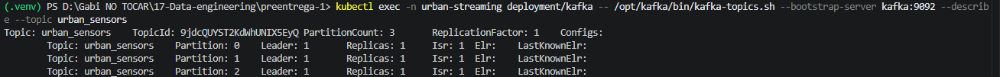

#### 3. Envío de eventos desde Python

El productor generó eventos JSON con los cinco campos solicitados y confirmó su publicación en Kafka.

Los registros del productor muestran el sensor, las mediciones, el timestamp y la partición asignada.

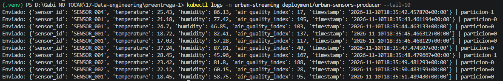

#### 4. Lectura de eventos desde Kafka

Se utilizó el consumidor de consola de Kafka para recuperar diez eventos desde `urban_sensors`.

La prueba finalizó con el mensaje:

`Processed a total of 10 messages`

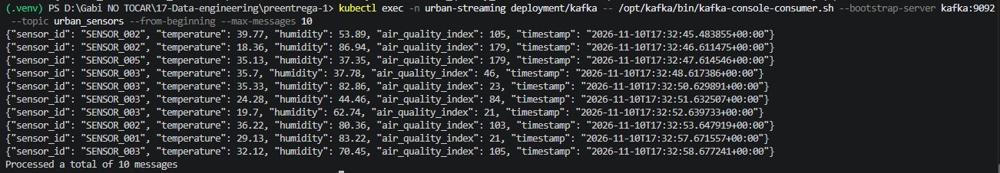

#### 5. Procesamiento con Spark Structured Streaming

Spark leyó los eventos JSON desde Kafka y calculó agregaciones por `sensor_id` utilizando ventanas temporales de un minuto.

Se observaron resultados reales con las columnas:

- `window`
- `sensor_id`
- `avg_temperature`
- `avg_air_quality_index`
- `total_events`

Los resultados se actualizaron entre distintos microbatches, demostrando el procesamiento continuo de los eventos.

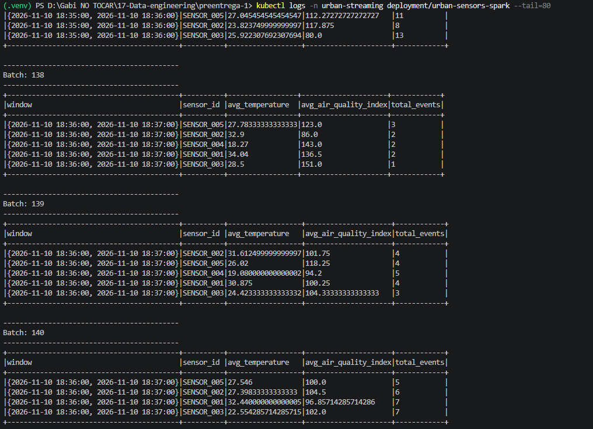

#### 6. Inicialización automática del tópico

El Job `kafka-topic-init` se ejecutó exitosamente y finalizó con:

`Complete 1/1`

Sus logs confirmaron la conexión con Kafka y la existencia del tópico `urban_sensors` con tres particiones.

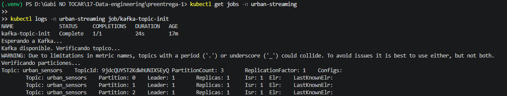

### Consideraciones técnicas y limitaciones

Esta implementación está orientada al aprendizaje y a la validación funcional del procesamiento de eventos.

- **Kubernetes local:** el clúster se ejecuta mediante kind sobre Docker Desktop, con un único nodo.
- **Kafka:** utiliza un broker/controlador KRaft. Las tres particiones permiten particionamiento lógico, pero no proporcionan alta disponibilidad.
- **Spark:** se ejecuta en modo `local[2]` dentro de un pod Kubernetes. No se implementa un clúster Spark multinodo.
- **Almacenamiento:** Kafka y los checkpoints de Spark utilizan almacenamiento temporal. La recreación de los pods puede ocasionar pérdida de datos o estado.
- **Seguridad:** los contenedores de aplicación se ejecutan con restricciones de privilegios. Kafka utiliza comunicación PLAINTEXT dentro del laboratorio local, por lo que esta configuración no debe exponerse directamente a redes públicas.
- **Conector Kafka:** Spark obtiene sus dependencias mediante Maven Central durante el inicio y necesita conectividad para descargarlas.
- **Costos:** no se desplegaron servicios AWS adicionales para esta etapa. El procesamiento utiliza recursos de la computadora local.

### Limpieza del entorno local

Para detener el productor sin eliminar su definición:

```powershell
kubectl scale deployment urban-sensors-producer --replicas=0 -n urban-streaming
```

Para restaurarlo posteriormente:

```powershell
kubectl scale deployment urban-sensors-producer --replicas=1 -n urban-streaming
```

Para eliminar completamente el clúster local y sus recursos:

```powershell
kind delete cluster --name urban-data
```

Si kind está instalado en la carpeta local de herramientas del usuario:

```powershell
& "$HOME\tools\kind.exe" delete cluster --name urban-data
```

**Advertencia:** eliminar el clúster destruye los recursos Kubernetes y los datos temporales asociados. No elimina los archivos del repositorio ni modifica la infraestructura AWS gestionada mediante Terraform.

### Resultado de la Pre-entrega 03

Se implementó y validó un pipeline funcional de eventos urbanos:

**Productor Python → Apache Kafka → Apache Spark Structured Streaming**

La solución recibe mediciones simuladas, las distribuye mediante un tópico de Kafka con tres particiones y calcula promedios de temperatura y calidad del aire por sensor en ventanas de un minuto.

Los manifiestos Kubernetes, Dockerfiles y scripts permiten reconstruir el entorno local siguiendo los pasos documentados.

---

## Pre-entrega 4 — Procesamiento streaming con Apache Flink en AWS

### Objetivo

Incorporar procesamiento *stateful* sobre los eventos de transacciones recibidos por **Amazon Kinesis Data Streams**, utilizando **Amazon Managed Service for Apache Flink** y una aplicación **PyFlink**. El ejercicio trabaja con tiempo de evento (*Event Time*), *watermarks*, ventanas temporales y *checkpoints*, manteniendo la infraestructura declarada en Terraform.

Esta etapa reutiliza la ingesta de la Pre-entrega 02. A diferencia de Firehose, cuyo propósito es entregar eventos crudos a S3 Bronze, Flink procesa y agrega eventos del stream. Ambos consumidores cumplen funciones distintas.

### Arquitectura

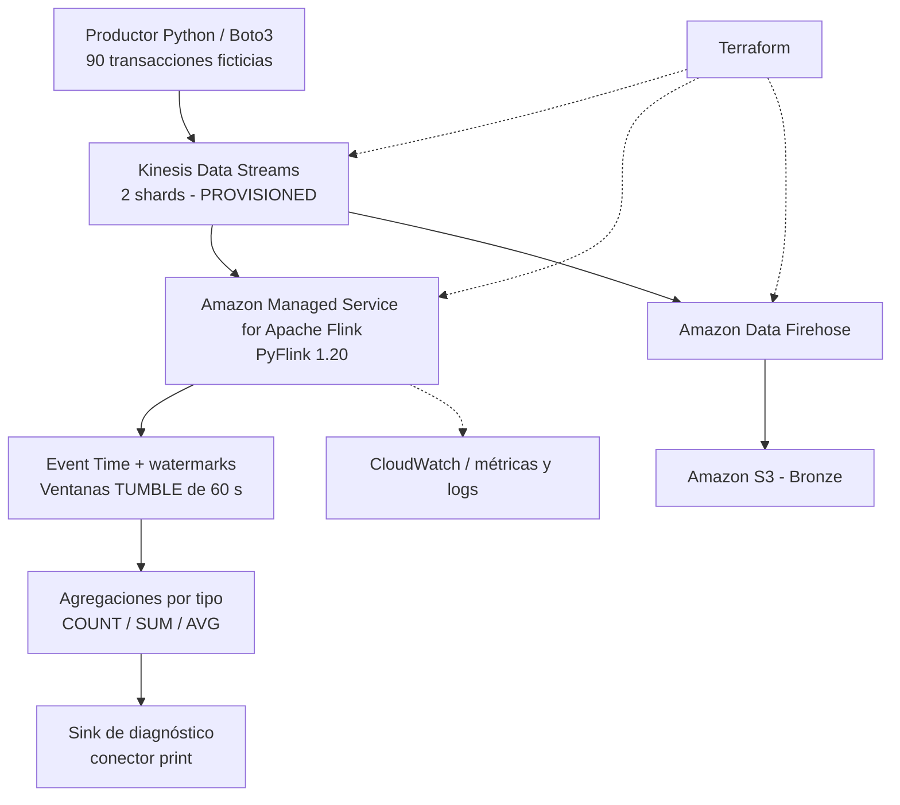

**Importante:** la salida `print` es un mecanismo de diagnóstico; **no** persiste las agregaciones en S3 ni constituye una tabla analítica permanente. La escritura de resultados finales en AWS no se confirmó directamente durante esta ejecución.

### Componentes implementados

| Componente | Función / configuración |
|---|---|
| `modules/flink` | Módulo Terraform para la aplicación administrada, permisos y logging. |
| `environments/dev` | Integración del módulo Flink con el stream Kinesis y los recursos existentes. |
| Amazon Managed Service for Apache Flink | Aplicación `data-engineering-dev-flink`, runtime Flink 1.20, paralelismo 1 y autoescalado desactivado durante las pruebas. |
| Kinesis Data Streams | Stream `data-engineering-dev-ingestion`, dos shards provisionados y retención de 24 horas. |
| Artefacto de ejecución | ZIP de la aplicación PyFlink almacenado en S3 bajo `artifacts/flink/application.zip`. |
| Productor | `scripts/producer_flink.py`, transacciones ficticias en JSON enviadas mediante Boto3. |
| Procesamiento | Ventanas `TUMBLE` de 60 segundos por `event_type`. |
| Métricas calculadas | Cantidad de transacciones, monto total y monto promedio (`COUNT`, `SUM`, `AVG`). |
| Salida | Tabla `transaction_metrics` con conector `print` para diagnóstico. |
| Tolerancia a fallos | Checkpoints habilitados, con intervalo configurado de 60 segundos. |
| Prueba local | `flink/test_windows.py`, ejecución PyFlink en modo *batch* con validación automática. |

### Lógica de procesamiento

Los eventos simulados incluyen un identificador de transacción, identificador de usuario, tipo de evento (`compra`, `pago`, `devolucion`), importe, moneda y timestamp UTC.

La aplicación toma el timestamp del evento para definir su tiempo de procesamiento lógico (*Event Time*) y utiliza *watermarks* para determinar el avance temporal del stream. Después agrupa los registros en ventanas no solapadas de un minuto mediante `TUMBLE` y, para cada `event_type`, calcula:

- `transaction_count`: cantidad de registros en la ventana.
- `total_amount`: suma de los importes.
- `average_amount`: promedio de los importes.

Estas agregaciones mantienen estado mientras se construye el resultado de cada ventana. El progreso observado de los *watermarks* en AWS permite confirmar que el mecanismo temporal estaba activo, aunque la captura no constituye una prueba de emisión de todas las ventanas al sink.

### Pruebas y resultados

#### 1. Ejecución de la aplicación administrada

Se desplegó la aplicación mediante Terraform y se ejecutó temporalmente en AWS. En el Dashboard de Flink se observó el grafo de operadores, incluyendo lectura de transacciones, asignación de *watermarks* y agregaciones de ventana.

La captura muestra **27 registros intermedios** en el flujo de agregación; este valor **no** debe interpretarse como el número total de eventos de entrada ni como una cantidad de resultados finales confirmados en el sink.

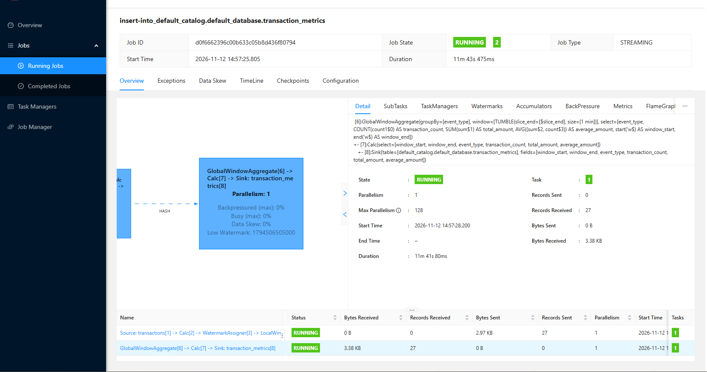

#### 2. Checkpoints

Durante la ejecución se observaron **35 checkpoints completados y 0 fallidos**. Esto verifica la ejecución del mecanismo de checkpoints durante la prueba, pero **no** implica que se haya ensayado la recuperación desde un checkpoint o ante una caída.

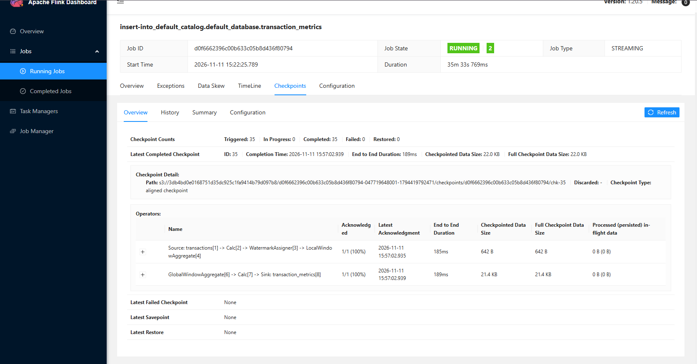

#### 3. Watermarks

El Dashboard mostró avance de *watermarks* de Event Time, evidenciando progreso temporal dentro del procesamiento streaming. No se realizó una prueba específica de comportamiento con eventos tardíos o particiones inactivas.

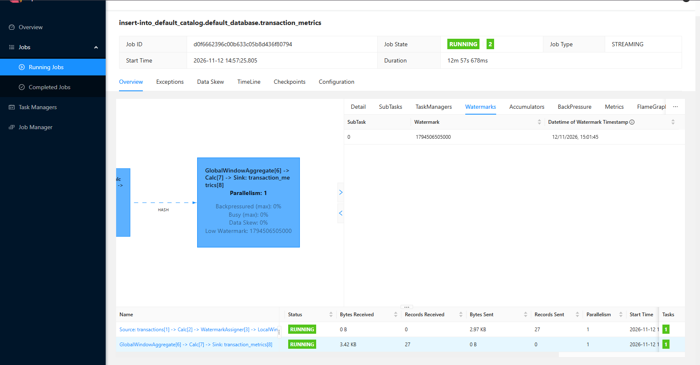

#### 4. Productor de transacciones

Se ejecutó `scripts/producer_flink.py` con una carga simulada de **90 transacciones**, enviada exitosamente a Kinesis. La confirmación del productor demuestra el envío aceptado, **no** que se hayan validado individualmente las 90 salidas de Flink.

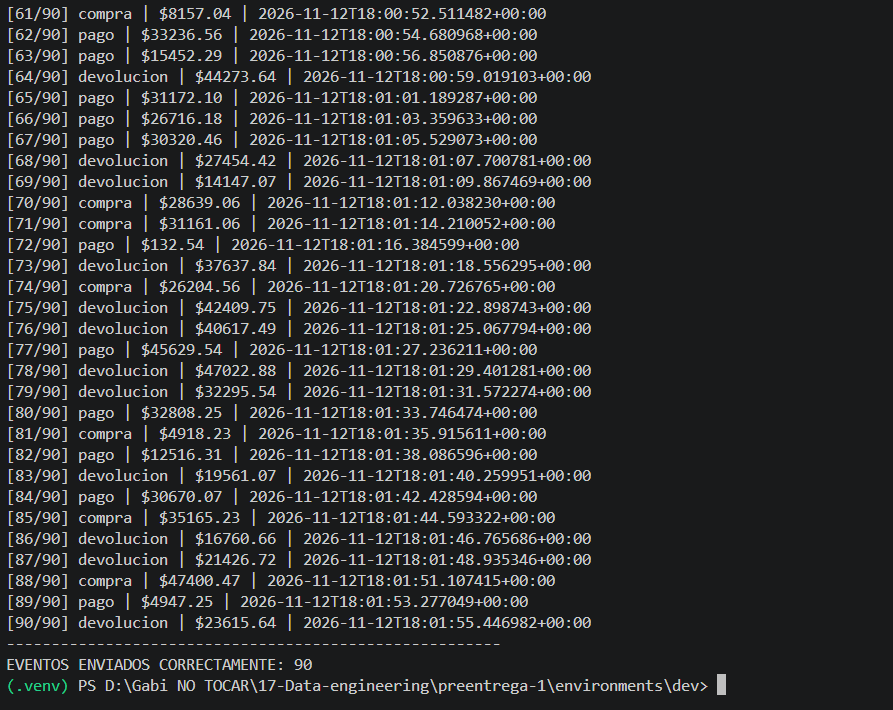

#### 5. Configuración del stream

Se verificó en la consola AWS que `data-engineering-dev-ingestion` se encontraba **activo**, en modo **PROVISIONED**, con **2 shards** y retención de **1 día** durante la prueba.

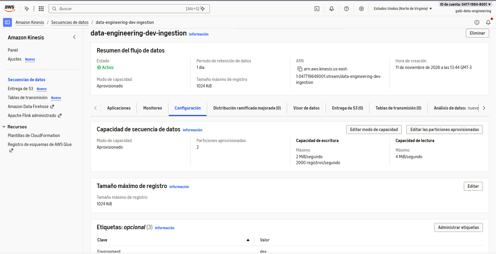

#### 6. Validación local de las agregaciones

Para comprobar los cálculos sin volver a encender recursos AWS, se ejecutó `flink/test_windows.py` en **Python 3.11.9**, con **PyFlink 1.20** y **Java 11**, en un entorno virtual separado `.venv-flink`.

La prueba emplea cuatro eventos ficticios y verifica automáticamente que la consulta de ventanas de 60 segundos devuelva los siguientes resultados:

| Ventana (UTC) | Tipo | Cantidad | Total | Promedio |
|---|---|---:|---:|---:|
| 2025-11-10 12:30–12:31 | compra | 2 | 3000.00 | 1500.00 |
| 2025-11-10 12:30–12:31 | pago | 1 | 500.00 | 500.00 |
| 2025-11-10 12:31–12:32 | compra | 1 | 3000.00 | 3000.00 |

El script compara las filas obtenidas con las esperadas, independientemente del orden de salida. La ejecución finalizó con:

```text
PRUEBA DE AGREGACIONES SUPERADA
Cantidad, suma y promedio correctos.
```

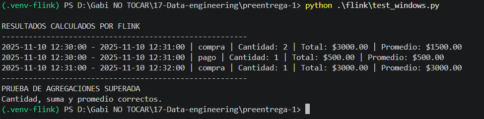

Para reproducir la prueba local, desde la raíz del repositorio y con Python 3.11 disponible:

```powershell
py -3.11 -m venv .venv-flink
.\.venv-flink\Scripts\Activate.ps1
python -m pip install apache-flink==1.20.3
python .\flink\test_windows.py
```

**Alcance de la validación:** se comprobó la lógica de agregación por ventanas en modo *batch*, sobre datos conocidos. Esta prueba reproduce la lógica SQL esencial, pero **no** verifica por sí sola los *watermarks* del stream de AWS, el comportamiento ante eventos tardíos ni la escritura final de la aplicación administrada. No es una prueba automatizada de extremo a extremo del pipeline de producción.

### Gestión de infraestructura y costos

Toda la infraestructura de la prueba se definió mediante Terraform. Tras recopilar las evidencias, se revisó un plan de destrucción dirigido al módulo Kinesis. La revisión detectó dependencias con la aplicación Flink, por lo que se decidió retirar **también la aplicación administrada** junto con los recursos temporales de ingesta.

El plan revisado incluyó **10 recursos**: ocho del módulo Kinesis/Firehose y dos del módulo Flink (aplicación y política asociada). Su aplicación terminó con:

```text
Apply complete! Resources: 0 added, 0 changed, 10 destroyed.
```

Se comprobó posteriormente que la consulta de aplicaciones Flink devolvía `[]` en `us-east-1`. Se conservaron el código fuente, las definiciones Terraform, el bucket S3 con el artefacto y la infraestructura base no incluida en el plan de limpieza.

> **Precaución:** los módulos eliminados continúan declarados en los archivos `.tf`. Un futuro `terraform plan` normal puede proponer su **recreación**, con nuevos costos. Antes de ejecutar `terraform apply`, revisar siempre el plan completo y confirmar qué servicios se encenderán. Los planes binarios de Terraform y ambos entornos virtuales están excluidos por `.gitignore`.

### Consideraciones y limitaciones

- **Procesamiento administrado:** se observó el job ejecutándose en AWS y se registraron checkpoints y watermarks; no se comprobó una recuperación real después de un fallo.
- **Resultados finales:** el conector `print` se usó para diagnóstico, pero no se obtuvo evidencia directa de las filas agregadas emitidas por el job AWS.
- **Prueba local:** las cantidades, sumas y promedios se verificaron mediante PyFlink en modo batch. No sustituye una validación streaming completa.
- **Paralelismo:** se utilizó paralelismo 1 para el laboratorio; no se evaluó escalado horizontal ni desempeño bajo carga.
- **Persistencia analítica:** no se implementó un sink persistente para los resultados de `transaction_metrics`; S3 Bronze continúa almacenando los datos crudos mediante Firehose, no estas métricas.
- **Costos:** los recursos de procesamiento e ingesta temporales se destruyeron al finalizar las pruebas; el resto de la infraestructura AWS debe seguir supervisándose por separado.

### Resultado de la Pre-entrega 04

Se implementó y ejecutó un flujo de procesamiento de eventos con **Python/Boto3 → Kinesis Data Streams → Apache Flink**, basado en Event Time, watermarks, ventanas de un minuto, agregaciones stateful y checkpoints.

La prueba en AWS permitió observar el funcionamiento del job administrado; la prueba local verificó automáticamente las agregaciones de cantidades, sumas y promedios. Se documentó explícitamente el alcance de cada validación y se limpiaron con Terraform los recursos temporales para controlar costos.

---

## Pre-entrega 05 — Lakehouse con Apache Iceberg, Flink y catálogo

### Objetivo y alcance

Persistir las métricas procesadas por Flink como una tabla transaccional de Apache Iceberg. El recorrido principal de este checkpoint es el **laboratorio local con LocalStack, PostgreSQL (JdbcCatalog), Flink e IcebergSink**, sin necesidad de desplegar infraestructura en una cuenta AWS. La implementación equivalente con Glue Data Catalog y Amazon S3 se conserva en la segunda parte de esta sección.

### Laboratorio local — LocalStack, PostgreSQL y Apache Iceberg

#### Arquitectura

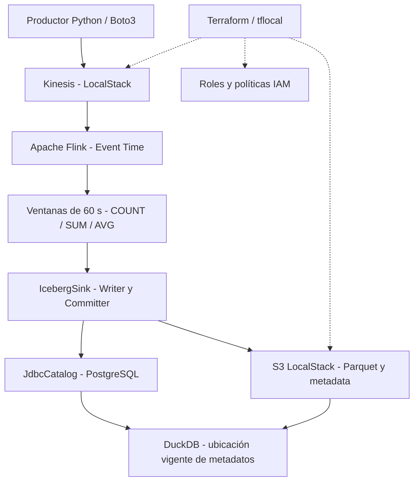

El catálogo JDBC conserva las referencias a los metadatos de la tabla; los datos, manifiestos y archivos JSON de metadatos se almacenan en S3. PostgreSQL no almacena las filas analíticas de Iceberg.

#### Componentes y versiones

| Componente | Configuración utilizada |
|---|---|
| Docker Engine / Compose | 29.9.3 / 5.7.0 |
| LocalStack | Imagen `localstack/localstack:latest`; S3, Kinesis, IAM y STS |
| PostgreSQL | `postgres:16-alpine`, base `lakehouse` |
| Flink | `flink:1.20.5-scala_2.12-java11`, JobManager y TaskManager |
| Capacidad local | Un TaskManager, dos slots; paralelismo del job y del escritor: 1 |
| Java / Maven | Java 11 / Maven 3.9.16 |
| Conector Kinesis | `flink-connector-aws-kinesis-streams`, versión `5.1.0-1.20` |
| Apache Iceberg | 1.10.1; runtime para Flink 1.20, `iceberg-aws-bundle`, formato de tabla v2 |
| PostgreSQL JDBC | 42.7.8 |
| Hadoop Client | 3.3.6 |
| AWS SDK | BOM 2.33.0 |
| Terraform / tflocal | 1.16.5 / 0.27.0 |
| Boto3 / DuckDB | 1.43.114 / 2.0.1 |
| Warehouse | `s3://lakehouse/warehouse` |
| Tabla | `lakehouse_db.transaction_metrics` |

`tflocal` se conserva como herramienta de ejecución del laboratorio. La versión utilizada muestra un aviso de deprecación, pero completó las operaciones de esta prueba. La etiqueta `latest` de LocalStack no fija una versión inmutable de la imagen.

#### Estructura de archivos

```text
app/
├── pom.xml
├── requirements.txt
├── producer_local.py
├── query_iceberg.py
└── src/main/java/com/dataengineering/
    └── LakehouseJob.java
infra/
├── main.tf
└── .terraform.lock.hcl
docker-compose.yml
.env.example
evidencias/preentrega-05/
```

La aplicación PyFlink y los módulos de AWS se mantienen en `flink/`, `modules/` y `environments/dev/`. El laboratorio utiliza un estado Terraform independiente, sin backend remoto. No se versionan `.env`, estados Terraform ni artefactos compilados.

#### 1. Preparar el entorno local

Los comandos se ejecutan en Windows PowerShell desde la raíz del repositorio, salvo indicación contraria. Requisitos: Docker Desktop en ejecución, Python, Java 11, Maven, Terraform y acceso a Internet para descargar imágenes y dependencias. La configuración actual requiere un token válido de LocalStack.

```powershell
python -m venv .venv
.\.venv\Scripts\Activate.ps1
python -m pip install -r app/requirements.txt

# Crear el archivo de configuración solo si todavía no existe.
if (-not (Test-Path .env)) { Copy-Item .env.example .env }
```

Completar `LOCALSTACK_AUTH_TOKEN`, `POSTGRES_USER` y `POSTGRES_PASSWORD` en `.env`. No publicar el token ni las credenciales reales. Las credenciales AWS de prueba `test/test` se utilizan únicamente contra LocalStack.

```powershell
docker compose config --quiet
docker compose up -d
docker compose ps
Invoke-RestMethod http://localhost:8081/overview | Select-Object taskmanagers,'slots-total','slots-available'
tflocal --version
```

Esperar que PostgreSQL y LocalStack estén saludables y que Flink registre un TaskManager. Los puertos de acceso desde el host se limitan a `127.0.0.1`: LocalStack `4566`, PostgreSQL `5433` y Flink `8081`. Dentro de Docker, PostgreSQL escucha en `postgres:5432` y LocalStack en `localstack:4566`.

**Resultado observado:** cuatro servicios operativos, un TaskManager registrado y dos slots disponibles.

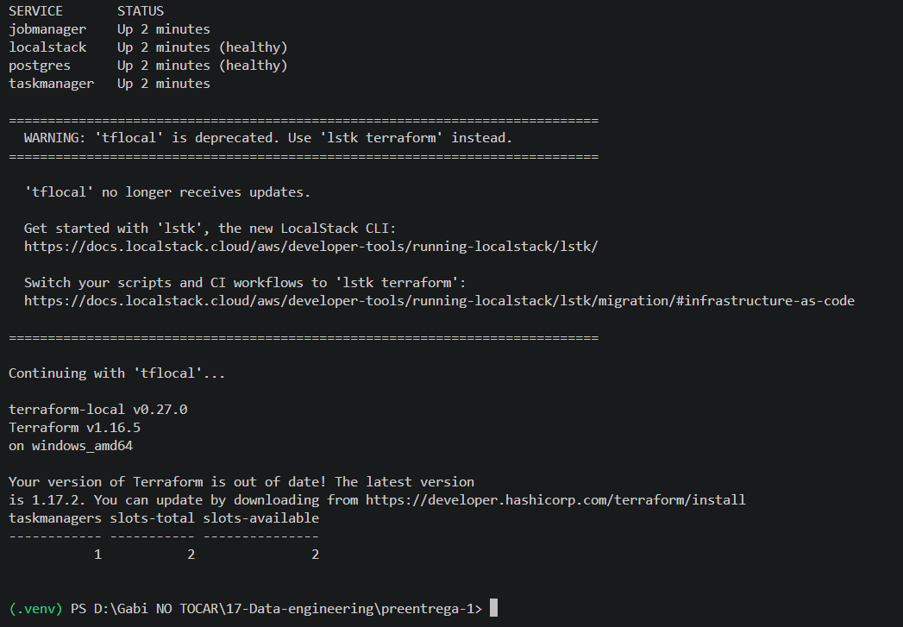

#### 2. Crear la infraestructura con Terraform

```powershell
cd infra
terraform fmt
tflocal init
terraform validate
tflocal plan
# Revisar el plan antes de confirmar la aplicación.
tflocal apply
cd ..
```

La configuración utiliza endpoints locales explícitos y credenciales ficticias. El recurso `aws_glue_catalog_database.lakehouse_db` está declarado con `count = 0` para validarlo sin intentar crear Glue en LocalStack; la definición activa de AWS se conserva en `modules/lakehouse/main.tf`.

En un entorno nuevo, el plan contempla cinco recursos: bucket S3 `lakehouse`, configuración de versionado, Kinesis Data Stream `data-engineering-local-stream` (dos shards), rol IAM de Flink y política IAM asociada. Los permisos incluyen `glue:GetTable`, `glue:CreateTable`, `glue:UpdateTable`, lectura/listado de S3 y escritura de objetos restringida a `warehouse/*`, además de los permisos de lectura de Kinesis. El rol representa la configuración de ejecución para AWS; el proceso Flink local usa las credenciales ficticias de LocalStack y no asume ese rol.

**Resultados observados:**

```text
Success! The configuration is valid.
Plan: 5 to add, 0 to change, 0 to destroy.
Apply complete! Resources: 5 added, 0 changed, 0 destroyed.
```

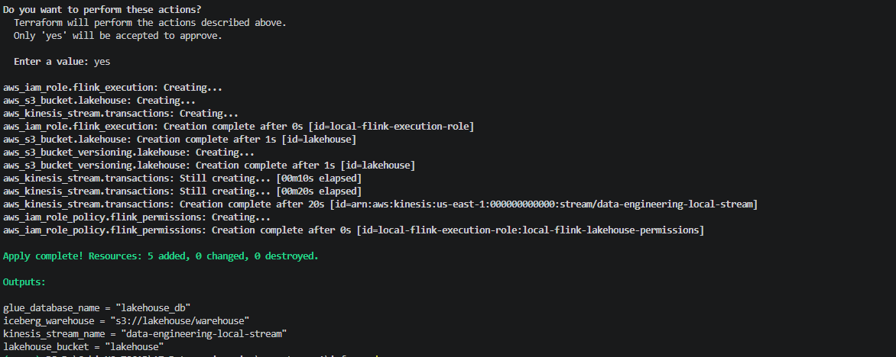

Verificar el versionado y el stream:

```powershell
docker compose exec -T localstack awslocal s3api get-bucket-versioning --bucket lakehouse
docker compose exec -T localstack awslocal kinesis describe-stream-summary --stream-name data-engineering-local-stream --query 'StreamDescriptionSummary.{Status:StreamStatus,Shards:OpenShardCount}'
```

Se comprobó `Enabled` para el versionado y `ACTIVE` para Kinesis, con dos shards.

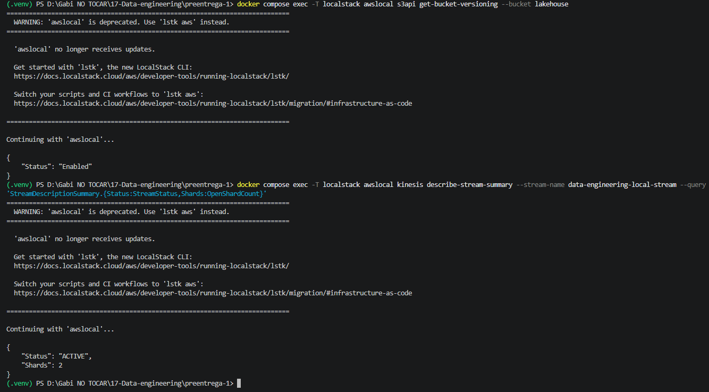

#### 3. Construir la aplicación Flink

```powershell
mvn -f app/pom.xml clean package
```

El artefacto generado es `app/target/lakehouse-local.jar`. El POM declara el runtime Iceberg compatible con Flink 1.20, `iceberg-aws-bundle`, el driver JDBC de PostgreSQL, el conector Kinesis y las dependencias de Hadoop. Maven Shade reúne las dependencias necesarias; las bibliotecas provistas por el runtime Flink se declaran con alcance `provided` cuando corresponde.

Se alinearon los módulos del AWS SDK mediante el BOM 2.33.0 para resolver una incompatibilidad de carga de clases (`AWS_AUTH_SCHEME_PREFERENCE`). Se declaró explícitamente el tipo `String` de la fuente Kinesis para evitar problemas de inferencia de tipos en Flink.

**Resultado observado:** `BUILD SUCCESS`. El JAR se reconstruye con el código y el POM versionados; no se publica el binario. Esta compilación se verificó en el directorio de desarrollo. No se afirma una segunda ejecución de extremo a extremo desde un clon limpio del laboratorio Java.

#### 4. Configurar el catálogo JDBC y ejecutar el job

La clase `LakehouseJob.java` configura `CatalogLoader.custom` con las siguientes propiedades:

| Propiedad | Valor local |
|---|---|
| Implementación | `org.apache.iceberg.jdbc.JdbcCatalog` |
| `uri` | `jdbc:postgresql://postgres:5432/lakehouse` |
| `jdbc.user` | Variable de entorno `POSTGRES_USER` |
| `jdbc.password` | Variable de entorno `POSTGRES_PASSWORD` |
| `warehouse` | `s3://lakehouse/warehouse` |
| `io-impl` | `org.apache.iceberg.aws.s3.S3FileIO` |
| `s3.endpoint` | `http://localstack:4566` |
| `s3.path-style-access` | `true` |
| `client.region` | `us-east-1` |
| `s3.access-key-id` / `s3.secret-access-key` | `test` / `test` |
| Namespace / tabla | `lakehouse_db.transaction_metrics` |

El código crea el namespace y la tabla si no existen, utilizando el esquema explícito y el particionado diario. Si la tabla ya existe, no la elimina ni recrea.

Obtener el ARN del stream local, copiar el JAR e iniciar Flink:

```powershell
$streamArn = docker compose exec -T localstack env AWS_ACCESS_KEY_ID=test AWS_SECRET_ACCESS_KEY=test AWS_DEFAULT_REGION=us-east-1 aws --endpoint-url=http://localhost:4566 kinesis describe-stream-summary --stream-name data-engineering-local-stream --query StreamDescriptionSummary.StreamARN --output text

docker compose cp app/target/lakehouse-local.jar jobmanager:/tmp/lakehouse-local.jar

docker compose exec -T jobmanager flink run -d -c com.dataengineering.LakehouseJob /tmp/lakehouse-local.jar $streamArn
```

Verificar el job `Preentrega 05 - Local Iceberg Lakehouse` en el [dashboard local de Flink](http://localhost:8081/). Esperar el estado `RUNNING` antes de enviar eventos.

**Resultado observado:** el job quedó en `RUNNING` con cuatro operadores activos, incluyendo el writer, el agregador de pre-commit y el committer de Iceberg.

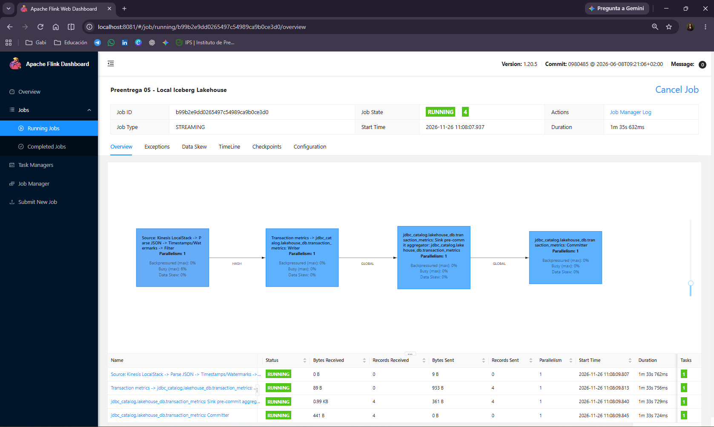

#### 5. Esquema, procesamiento y checkpointing

La entrada mantiene el contrato de eventos JSON del pipeline anterior (`transaction_id`, `user_id`, `event_type`, `amount`, `currency`, `timestamp` UTC). La aplicación local extrae los campos necesarios para agrupar por tipo de evento. Utiliza Event Time, ventanas no solapadas de 60 segundos, watermarks con tolerancia de 10 segundos y detección de inactividad de 30 segundos.

| Columna Iceberg | Tipo | Obligatoria |
|---|---|---|
| `window_start` | timestamp sin zona horaria (UTC por convención) | Sí |
| `window_end` | timestamp sin zona horaria (UTC por convención) | Sí |
| `event_type` | string | Sí |
| `transaction_count` | long | Sí |
| `total_amount` | double | No |
| `average_amount` | double | No |

Las métricas se calculan mediante agregación incremental, con `COUNT`, `SUM` y `AVG`. Los resultados se convierten a `RowData` y se escriben en Iceberg mediante la API Java explícita:

```java
IcebergSink.forRowData(metrics)
    .tableLoader(tableLoader)
    .writeParallelism(1)
    .append();
```

La tabla utiliza Iceberg v2 y Parquet. Se configuran checkpoints cada 60 segundos con modo `EXACTLY_ONCE`, timeout de 120 segundos y un máximo de un checkpoint concurrente. Los checkpoints completados permiten al sink confirmar los archivos y actualizar los metadatos transaccionales. La configuración no implica que se haya ensayado recuperación ante fallos ni garantiza deduplicación entre ejecuciones independientes.

#### 6. Prueba controlada de persistencia (26/11/2026)

```powershell
python app/producer_local.py
```

El productor envía cinco eventos en la misma ventana temporal, con importes conocidos, y un sexto evento en una ventana posterior para avanzar el watermark. Se usa una clave de partición constante en esta prueba controlada; los seis eventos fueron aceptados en el shard 0. Esto no representa una prueba de distribución de carga entre shards.

| Tipo | Importes de la ventana | Cantidad esperada | Total esperado (ARS) | Promedio esperado (ARS) |
|---|---|---:|---:|---:|
| PURCHASE | 100, 200, 300 | 3 | 600,00 | 200,00 |
| REFUND | 50, 150 | 2 | 200,00 | 100,00 |

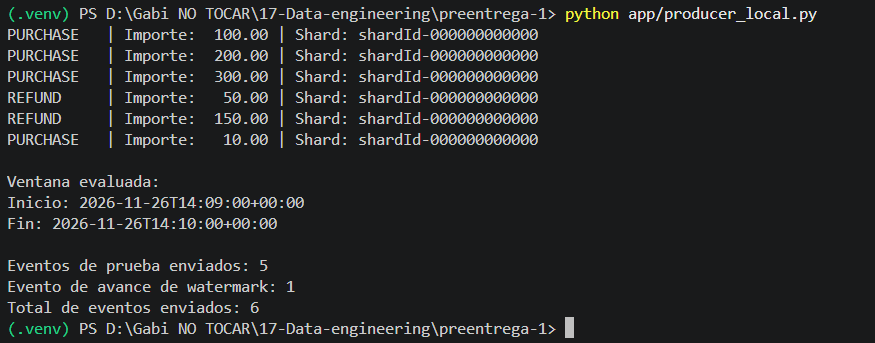

El sexto evento (`PURCHASE`, importe 10) no pertenece a la ventana evaluada. Ejecutar el productor una sola vez en un laboratorio nuevo para reproducir esta prueba. La fuente utiliza `TRIM_HORIZON`: volver a iniciar el job sin restaurar su estado puede reprocesar los eventos y generar duplicados en la tabla append-only.

En la pestaña **Checkpoints** del dashboard se verificó que el checkpoint posterior a la prueba estuviera completado.

| Indicador observado | Resultado |
|---|---:|
| Checkpoints iniciados / completados | 5 / 5 |
| Checkpoints fallidos | 0 |
| Último checkpoint observado | 5 |
| Duración del último checkpoint | 491 ms |
| Operadores confirmados | 4 de 4 |

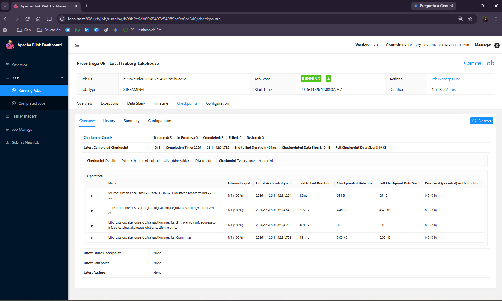

Se revisaron los logs disponibles del JobManager y TaskManager:

```powershell
docker compose logs --no-color jobmanager taskmanager | Select-String -Pattern 'ConcurrentModificationException|Concurrent Modification Exception|CommitFailedException|CommitStateUnknownException'
```

La búsqueda no devolvió coincidencias durante la ejecución validada. Este resultado comprueba la ausencia observada de esos errores en la prueba con un escritor; no es una prueba de estrés con varios escritores concurrentes.

#### 7. Verificar los metadatos Iceberg en S3

```powershell
docker compose exec -T localstack env AWS_ACCESS_KEY_ID=test AWS_SECRET_ACCESS_KEY=test AWS_DEFAULT_REGION=us-east-1 aws --endpoint-url=http://localhost:4566 s3 ls s3://lakehouse/warehouse/ --recursive

docker compose exec -T localstack env AWS_ACCESS_KEY_ID=test AWS_SECRET_ACCESS_KEY=test AWS_DEFAULT_REGION=us-east-1 aws --endpoint-url=http://localhost:4566 s3 ls s3://lakehouse/warehouse/lakehouse_db/transaction_metrics/metadata/
```

Salida observada del listado de `metadata/` (líneas correspondientes a los JSON):

```text
2026-11-26 13:45:17       1135 00000-5effed8e-7fd3-430b-bf1a-499c356965f9.metadata.json
2026-11-26 14:12:25       2267 00001-063b5ded-a510-496d-8612-20daff8616f0.metadata.json
```

También se observaron un manifiesto Avro (`-m0.avro`), una lista de manifiestos del snapshot (`snap-*.avro`) y un archivo Parquet de 1.993 bytes en `data/window_start_day=2026-11-26/`. La nueva versión de metadatos es posterior al checkpoint de la prueba. Los nombres UUID y los horarios cambiarán en una nueva ejecución.

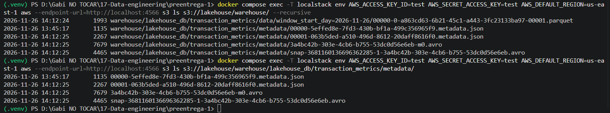

#### 8. Verificar el registro en PostgreSQL

```powershell
$pgUser = docker compose exec -T postgres printenv POSTGRES_USER

docker compose exec -T postgres psql -U $pgUser -d lakehouse -c "SELECT table_namespace, table_name, metadata_location FROM iceberg_tables;"
```

Se obtuvo una fila con `table_namespace = lakehouse_db`, `table_name = transaction_metrics` y `metadata_location` apuntando a `s3://lakehouse/warehouse/lakehouse_db/transaction_metrics/metadata/00001-063b5ded-a510-496d-8612-20daff8616f0.metadata.json`. Esto confirma que el catálogo JDBC registra la versión actualizada de los metadatos, no solamente la existencia física de archivos.

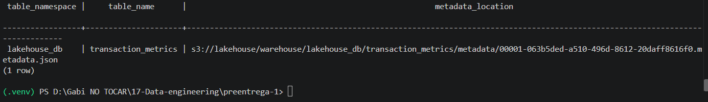

#### 9. Consultar Iceberg mediante DuckDB

Obtener la referencia vigente del catálogo y ejecutar la consulta:

```powershell
$pgUser = docker compose exec -T postgres printenv POSTGRES_USER
$metadataLocation = docker compose exec -T postgres psql -U $pgUser -d lakehouse -At -c "SELECT metadata_location FROM iceberg_tables WHERE table_namespace = 'lakehouse_db' AND table_name = 'transaction_metrics';"

python app/query_iceberg.py $metadataLocation
```

El script instala y carga las extensiones `httpfs` e `iceberg`, configura un secreto S3 de prueba limitado a `s3://lakehouse/` y consulta mediante `iceberg_scan`, respetando los metadatos y snapshots de la tabla, sin depender de un archivo Parquet seleccionado manualmente.

Consulta ejecutada por el script, donde `?` recibe la ubicación vigente de metadatos:

```sql
SELECT
    window_start,
    window_end,
    event_type,
    transaction_count,
    total_amount,
    average_amount
FROM iceberg_scan(?)
ORDER BY window_start, event_type;
```

**Resultados obtenidos:**

| Ventana UTC | Tipo | Cantidad | Total (ARS) | Promedio (ARS) |
|---|---|---:|---:|---:|
| 2026-11-26 14:09:00–14:10:00 | PURCHASE | 3 | 600,00 | 200,00 |
| 2026-11-26 14:09:00–14:10:00 | REFUND | 2 | 200,00 | 100,00 |

Los seis valores agregados coinciden con los esperados. Las dos filas corresponden a cinco eventos de la ventana cerrada; el sexto evento se utilizó para el avance temporal.

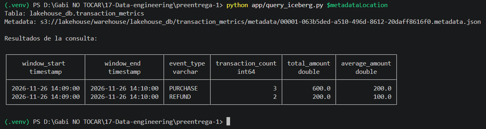

#### 10. Estrategia de particionado y Partition Pruning

Se eligió particionado diario sobre `window_start` porque las métricas de streaming son temporales y pueden consultarse por rangos de fechas. La definición utiliza:

```java
PartitionSpec.builderFor(schema)
    .day("window_start")
    .build();
```

Iceberg administra esta transformación mediante **Hidden Partitioning**. El usuario consulta la columna original, sin tener que agregar manualmente una columna de fecha de partición. Por ejemplo, con la ubicación de metadatos vigente y la conexión DuckDB configurada:

```sql
SELECT *
FROM iceberg_scan('s3://lakehouse/warehouse/lakehouse_db/transaction_metrics/metadata/00001-063b5ded-a510-496d-8612-20daff8616f0.metadata.json')
WHERE window_start >= TIMESTAMP '2026-11-26 00:00:00'
  AND window_start < TIMESTAMP '2026-11-27 00:00:00';
```

El motor compatible con Iceberg puede proyectar el filtro temporal sobre la especificación de particionado y utilizar los metadatos para descartar particiones o archivos irrelevantes (**Partition Pruning**). Esto reduce lecturas y puede mejorar tiempos de respuesta y costos de consultas, especialmente a mayor volumen. La granularidad diaria evita una partición por cada ventana de un minuto; su conveniencia depende del volumen real y de los patrones de consulta.

La ejecución comprobó el directorio `window_start_day=2026-11-26/`. La consulta filtrada anterior es un ejemplo de referencia, no una prueba adicional de rendimiento. No se midió comparativamente el volumen leído con y sin pruning ni se evaluaron múltiples días.

#### 11. JDBC Catalog frente a AWS Glue Data Catalog

Ambas implementaciones conservan el mismo formato de tabla Iceberg y las referencias a los metadatos en S3. El catálogo JDBC utiliza PostgreSQL como metastore; Glue utiliza un servicio administrado por AWS.

| Propiedad | Laboratorio local | AWS real |
|---|---|---|
| Implementación | `org.apache.iceberg.jdbc.JdbcCatalog` | `org.apache.iceberg.aws.glue.GlueCatalog` |
| `uri` | `jdbc:postgresql://postgres:5432/lakehouse` | Eliminar |
| `jdbc.user`, `jdbc.password` | Variables de PostgreSQL | Eliminar |
| `warehouse` | `s3://lakehouse/warehouse` | `s3://BUCKET_DATOS/lakehouse/` |
| `io-impl` | `org.apache.iceberg.aws.s3.S3FileIO` | Mantener |
| `s3.endpoint` | `http://localstack:4566` | Eliminar para usar endpoints AWS |
| `s3.path-style-access` | `true` | Eliminar para usar el comportamiento predeterminado |
| `s3.access-key-id`, `s3.secret-access-key` | Credenciales ficticias | Eliminar; utilizar el rol IAM y la cadena de credenciales AWS |
| `client.region` | `us-east-1` | Región del entorno AWS |
| Consulta | DuckDB | Amazon Athena |

Para migrar se debe modificar la implementación del catálogo en `CatalogLoader`, configurar la ruta del warehouse real, retirar los parámetros JDBC y las credenciales/endpoints de simulación, y autorizar el rol Flink sobre Glue y S3. También se adapta la configuración de la fuente Kinesis al ARN y las credenciales del entorno real. El esquema lógico, la transformación de particionado y la lógica de agregación pueden mantenerse; la variante AWS existente utiliza PyFlink SQL, mientras que el laboratorio local utiliza la API Java `IcebergSink`. Esta comparación no implica que se haya ejecutado el nuevo JAR Java sobre AWS.

#### 12. Reproducibilidad, alcance y detención

Para reproducir el laboratorio seguir las secciones 1–9 en orden. Maven reconstruye el JAR, `app/requirements.txt` registra las versiones Python utilizadas y `infra/.terraform.lock.hcl` fija los providers seleccionados. Las imágenes y extensiones requieren descarga inicial; la imagen LocalStack con etiqueta `latest` puede cambiar. El ensayo documentado no incluye recuperación ante fallos, múltiples escritores ni una prueba de carga.

Para detener los contenedores sin eliminar sus volúmenes:

```powershell
docker compose down
```

Se conservan los volúmenes de PostgreSQL y LocalStack; la conservación de recursos de LocalStack depende de su mecanismo de persistencia. No se configuró almacenamiento externo de checkpoints de Flink, por lo que no debe asumirse la recuperación automática de su estado al recrear contenedores. El estado local de Terraform se conserva en `infra/` y no se versiona. No se requieren operaciones sobre AWS real para ejecutar este laboratorio.

**Resultado del laboratorio:** se verificó el recorrido Python/Boto3 → Kinesis LocalStack → Flink → IcebergSink Java → S3 LocalStack, con PostgreSQL como JdbcCatalog y DuckDB como motor de consulta. La prueba demostró persistencia de datos y metadatos, actualización del catálogo y consistencia de las métricas, con cinco checkpoints completados y cero fallidos en el momento de la captura.

---

### Variante AWS — Managed Flink, Glue Data Catalog y Athena


#### Objetivo y alcance

Extender el procesamiento de la Pre-entrega 04 con una salida analítica **persistente en formato Apache Iceberg**. Las transacciones llegan como JSON a **Amazon Kinesis Data Streams** y **Amazon Managed Service for Apache Flink** calcula métricas por ventanas; el resultado se escribe **directamente desde Flink a una tabla Iceberg almacenada en S3**, cuyo catálogo se administra mediante **AWS Glue Data Catalog**.

La arquitectura contempla en paralelo el camino independiente **Kinesis → Firehose → S3 Bronze** para eventos crudos durante los despliegues de streaming. **No se utiliza un trabajo Glue ETL intermedio para la escritura de las métricas**. AWS Glue cumple el papel de catálogo de metadatos; no procesa estos eventos.

#### Arquitectura

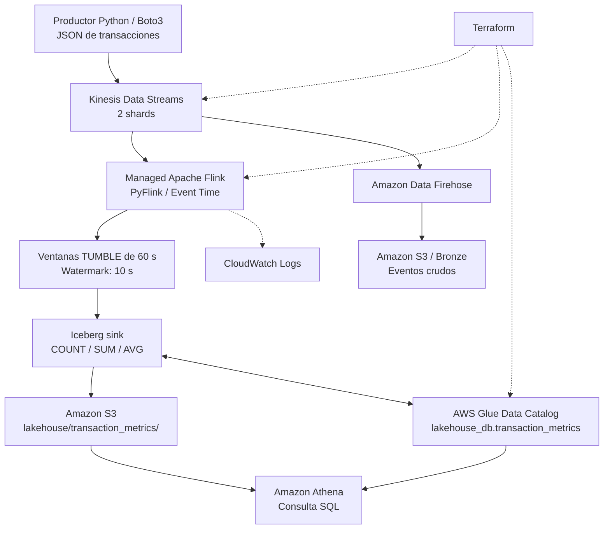

#### Componentes, configuraciones y archivos

| Componente | Implementación |
|---|---|
| Base y catálogo | `modules/lakehouse/`: base Glue `lakehouse_db` y tabla Iceberg `transaction_metrics` |
| Almacenamiento | S3, prefijo `lakehouse/transaction_metrics/`; datos Parquet y metadatos Iceberg |
| Procesamiento | `flink/main.py`: fuente Kinesis, tiempo de evento, agregaciones y sink directo Iceberg |
| Entrada | Stream `data-engineering-dev-ingestion`, modo provisionado, 2 shards |
| Ventanas | `WINDOW_SECONDS = 60` y `WATERMARK_SECONDS = 10` |
| Métricas | `transaction_count`, `total_amount`, `average_amount`, agrupadas por ventana y `event_type` |
| Catálogo | Glue Catalog, integrado con Iceberg y S3 |
| Consulta SQL | Amazon Athena, catálogo `AwsDataCatalog`, base `lakehouse_db`, workgroup `primary` |
| Permisos de consulta | `environments/dev/athena_query_iam.tf`: política IAM administrada y asociación al grupo `data-engineering-lab` |
| Resultados de Athena | `s3://data-engineering-dev-047719648001/athena-results/pre05/` |
| Dependencias del JAR | Iceberg 1.10.1, Hadoop 3.3.6, conector Kinesis `5.0.0-1.20`; compilación Java 11 |
| Empaquetado | `flink/pom.xml` → `flink/target/pyflink-dependencies.jar`; `flink/build_package.py` → `flink/application-pre05.zip` |
| Publicación del artefacto | `environments/dev/flink_artifact.tf` → S3 `artifacts/flink/application.zip` |
| Infraestructura | `modules/flink/`, `modules/kinesis/`, `modules/lakehouse/`, `environments/dev/` |
| Control de costos | `environments/dev/streaming_control.tf`, variable `enable_streaming` con valor predeterminado `false` |
| Productor y pruebas | `scripts/producer_flink.py`, `tests/test_producer_flink.py` |

El esquema de entrada JSON utilizado por Flink contiene `transaction_id`, `user_id`, `event_type`, `amount`, `currency` y `timestamp`. Este último llega como texto ISO-8601 UTC y se convierte a tiempo de evento (`event_time`). La aplicación utiliza `source.init.position = LATEST`; por ello, una nueva prueba debe publicar **eventos posteriores al inicio del job**.

La tabla Iceberg mantiene las columnas `window_start`, `window_end`, `event_type`, `transaction_count`, `total_amount` y `average_amount`, con archivos de datos organizados bajo particiones de `window_day`.

#### Resolución de compatibilidad Java / Hadoop

Durante el desarrollo se detectó un problema de carga de clases de Hadoop al inicializar Iceberg (`NoClassDefFoundError` relacionado con `org/apache/hadoop/conf/Configuration`). Se aisló la corrección en un laboratorio local y se integró finalmente en el Maven principal:

- Clase Java de soporte en `flink/src/main/java/org/apache/flink/runtime/util/HadoopUtils.java`.
- Compilación con `maven-compiler-plugin` para **Java 11** y dependencia `flink-core` con alcance `provided`.
- Reubicación Maven Shade de `org.apache.hadoop.conf` a `shaded.org.apache.hadoop.conf`.
- Reubicación de `org.apache.flink.runtime.util.HadoopUtils` a `shadow.org.apache.flink.runtime.util.HadoopUtils`.
- Exclusión de `commons-cli` para evitar duplicación con el runtime.

También se retiró una opción no soportada por el conector Kinesis utilizado (`scan.shard.idle.interval`), después de identificar una `ValidationException` de Flink. La aplicación pudo iniciar correctamente en AWS tras dicha corrección.

**Alcance de las pruebas:** la ejecución de extremo a extremo en AWS se realizó con el paquete **experimental ya corregido**. Posteriormente, las mismas correcciones se incorporaron al `pom.xml` y al código definitivos: Maven finalizó en `BUILD SUCCESS`, se comprobaron las clases esenciales dentro del JAR, se validó la estructura e integridad del ZIP definitivo y se publicó ese ZIP en S3 mediante Terraform. **El ZIP definitivo no se volvió a ejecutar en AWS después de la consolidación**; no se afirma una segunda validación de extremo a extremo de ese artefacto.

#### Construcción y verificaciones locales

Requisitos: Java y Maven compatibles con Java 11, Python disponible en un entorno virtual, Terraform y AWS CLI configurados para una cuenta autorizada. Las pruebas de PyFlink se realizaron con Python 3.11, Java 11 y la rama Flink 1.20.

Desde la **raíz del repositorio**, en PowerShell:

```powershell
# Compilar el JAR con la configuración principal.
mvn -f .\flink\pom.xml -DskipTests package

# Construir el ZIP: main.py + lib/pyflink-dependencies.jar.
python .\flink\build_package.py

# Comprobar las clases principales del JAR.
jar tf .\flink\target\pyflink-dependencies.jar | Select-String -Pattern "shadow/org/apache/flink/runtime/util/HadoopUtils.class|shaded/org/apache/hadoop/conf/Configuration.class|org/apache/iceberg/flink/FlinkCatalogFactory.class|org/apache/iceberg/aws/glue/GlueCatalog.class"

# Ejecutar tests sin conectar el productor a AWS.
python -m unittest discover -s .\tests -p "test_*.py" -v
```

**Resultados verificados en el directorio de desarrollo:** `BUILD SUCCESS`, paquete ZIP con estructura/integridad/hashes correctos y **10 tests automatizados exitosos**. Las pruebas incluyen campos requeridos, tipos, rangos de importes, serialización y fecha UTC; además, casos negativos para campos faltantes, montos inválidos, tipo de evento desconocido y fechas inválidas.

El archivo `flink/application-pre05.zip` se genera localmente y está excluido de Git. **Debe reconstruirse antes de `terraform validate` o `terraform plan` que lea su hash**. Los archivos experimentales y copias de seguridad no forman parte de la entrega final.

#### Prueba de reproducibilidad desde un clon limpio (22/11/2026)

**Resultado técnico: reconstrucción exitosa.** Se reconstruyeron el JAR y `flink/application-pre05.zip` desde un clon independiente de la rama `feature/lakehouse`, sin copiar artefactos del directorio de desarrollo. Esta prueba verifica la posibilidad de reconstruir el paquete usando los archivos versionados.

**Commit de origen validado:** `1c36634` (`feat: implementar lakehouse Iceberg con Flink y Glue`). Se hizo un commit local antes del experimento para que el clon incluyera los archivos nuevos, como `flink/build_package.py`, `flink/pom.xml` y la clase Java de compatibilidad.

**Requisitos:** Git, Maven, Java 11 y Python compatible con el script de empaquetado, con dependencias Maven disponibles. No se requiere Terraform, AWS ni encender Kinesis o Flink. Los comandos siguientes son para **Windows PowerShell** desde la raíz del proyecto original:

```powershell
# Crear un clon independiente desde la rama versionada.
git clone --branch feature/lakehouse --single-branch . "..\pre05-clon-limpio"

# Confirmar el commit y la ausencia de compilados en el nuevo clon.
git -C "..\pre05-clon-limpio" log -1 --oneline
Test-Path "..\pre05-clon-limpio\flink\target\pyflink-dependencies.jar"
Test-Path "..\pre05-clon-limpio\flink\application-pre05.zip"

# Compilar desde el clon, sin usar el JAR del repositorio original.
mvn -f "..\pre05-clon-limpio\flink\pom.xml" -DskipTests package

# Construir y validar el ZIP usando el script del propio clon.
Push-Location "..\pre05-clon-limpio"
python .\flink\build_package.py
Pop-Location
```

**Evidencia real observada:** `git log` devolvió el commit `1c36634`; ambos `Test-Path` devolvieron **`False`** antes de la compilación; Maven terminó con **`BUILD SUCCESS`**; `build_package.py` informó:

```text
ZIP GENERADO CORRECTAMENTE
ESTRUCTURA OK
INTEGRIDAD OK
HASHES OK
TAMANO: 185.67 MiB
```

El paquete contiene `main.py` y `lib/pyflink-dependencies.jar` y se validó su integridad mediante el script versionado. **Alcance:** se demuestra la reproducibilidad de construcción **a partir de los archivos controlados por Git**, no un build hermético sin red ni sin caché Maven. Tampoco se afirma haber vuelto a ejecutar el paquete reconstruido en AWS; esa diferencia se documenta en las limitaciones.

La captura del resultado se conserva como `evidencias/preentrega-05/10_reproducibilidad_clon_limpio.png`. También se verificó previamente en consola la ausencia del JAR y ZIP en el clon antes de la reconstrucción.

#### Prueba real de extremo a extremo en AWS (19/11/2026)

Se desplegaron temporalmente los recursos con Terraform, se inició Managed Flink y se enviaron **seis eventos sintéticos** a Kinesis con Boto3, distribuidos de manera explícita entre los dos shards: **tres en el shard 0 y tres en el shard 1**.

Cuatro transacciones correspondían a una ventana anterior; dos eventos adicionales, con timestamps posteriores, ayudaron al avance de los watermarks. Se utilizaron los tipos `compra` y `recarga` para verificar las agrupaciones. El tipo `recarga` fue parte de esta **prueba manual**: el productor habitual `scripts/producer_flink.py` genera y valida `compra`, `pago` y `devolucion`. El campo `event_type` del esquema de lectura de Flink admite texto y no restringe por sí mismo esos valores.

**Resultados comprobados en la ventana UTC `2026-11-19 19:35:00`–`19:36:00`:**

| Tipo | `transaction_count` | `total_amount` (ARS) | `average_amount` (ARS) |
|---|---:|---:|---:|
| `compra` | 3 | 4.500,00 | 1.500,00 |
| `recarga` | 1 | 1.000,00 | 1.000,00 |

La lectura del archivo Parquet con PyArrow confirmó estos valores. Los **dos registros** de Iceberg son **dos filas agregadas**, no dos eventos de entrada. No se verificó la persistencia de una segunda ventana para los dos eventos enviados al final.

Además se verificó:

- El job de Managed Flink alcanzó `RUNNING` antes del envío de eventos.
- La tabla `lakehouse_db.transaction_metrics` estaba registrada en Glue y apuntaba a un archivo `metadata.json` de Iceberg en S3.
- El metadato Iceberg contenía **tres snapshots**, con operación actual `append`, **dos registros**, un archivo Parquet de **1.990 bytes** y `engine-name: flink`.
- El snapshot registró `flink.max-committed-checkpoint-id: 22`: evidencia del commit de resultados vinculado al checkpoint.
- La aplicación fue detenida y regresó a `READY` antes de la limpieza de recursos.

**Comprobaciones de consulta sin reiniciar Flink:**

```powershell
# Metadatos del catálogo (con credenciales AWS autorizadas).
aws glue get-table --database-name lakehouse_db --name transaction_metrics --region us-east-1 --query "Table.{location:StorageDescriptor.Location,metadata:Parameters.metadata_location}" --output json

# Listar archivos persistidos en S3. Sustituir BUCKET_DATOS.
aws s3 ls "s3://BUCKET_DATOS/lakehouse/transaction_metrics/" --recursive --region us-east-1
```

Para validar los datos de una tabla Iceberg en general debe respetarse el snapshot actual y sus manifiestos; un listado de S3 por sí solo **no** identifica necesariamente los archivos vigentes cuando existen varios snapshots. En esta prueba se consultó el snapshot y se leyó el único archivo Parquet de datos localizado, concordante con el único archivo de datos del snapshot actual.

#### Evidencias de la Pre-entrega 05

Las capturas se ubican en `evidencias/preentrega-05/` y se presentan en el orden del flujo y las validaciones. No fue necesario recrear servicios de AWS para obtener capturas adicionales después de la limpieza.

##### 1. Datos agregados escritos en Iceberg

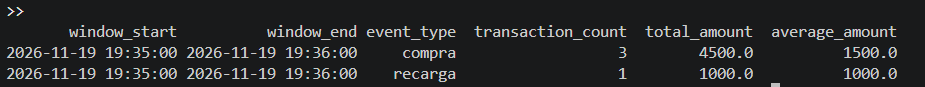

##### 2. Snapshot y checkpoint de Flink

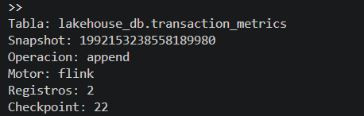

##### 3. Respaldo local de logs CloudWatch

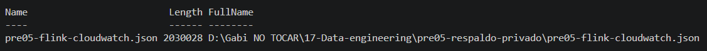

Se guardó una copia del registro completo de CloudWatch en una carpeta **privada fuera del repositorio**. Esa copia puede contener identificadores operativos y **no** se publica en Git. La captura demuestra la existencia del respaldo, no constituye por sí sola una prueba de ausencia de errores.

##### 4. Publicación Terraform del paquete definitivo

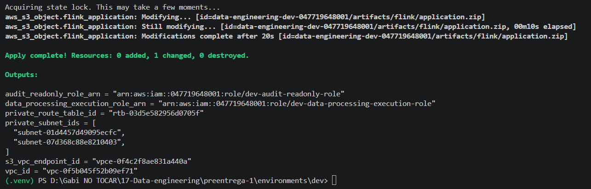

##### 5. Terraform sin cambios con streaming desactivado

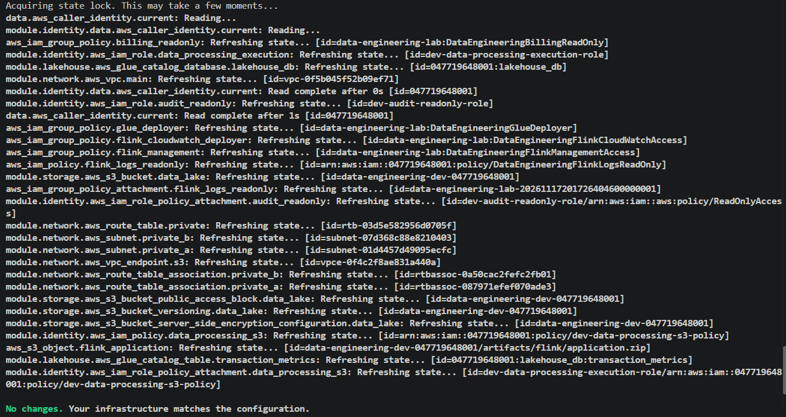

##### 6. Pruebas automáticas

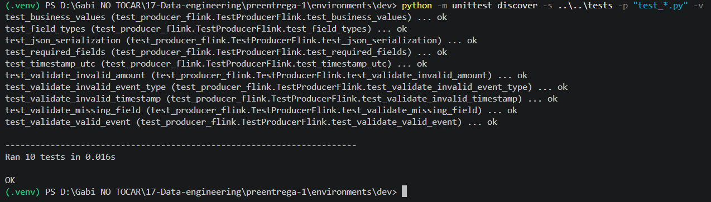

##### 7. Envío a los dos shards de Kinesis

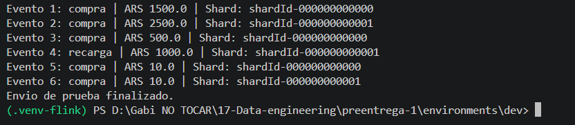

##### 8. Registro de la tabla Iceberg en Glue Data Catalog

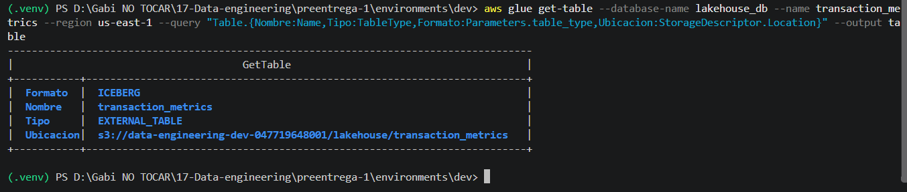

La consulta `aws glue get-table` confirmó `lakehouse_db.transaction_metrics`, tipo `ICEBERG` y ubicación de los datos en S3. Esta verificación del catálogo es independiente de la consulta posterior de filas en Athena.

##### 9. Consulta SQL exitosa desde Amazon Athena (22/11/2026)

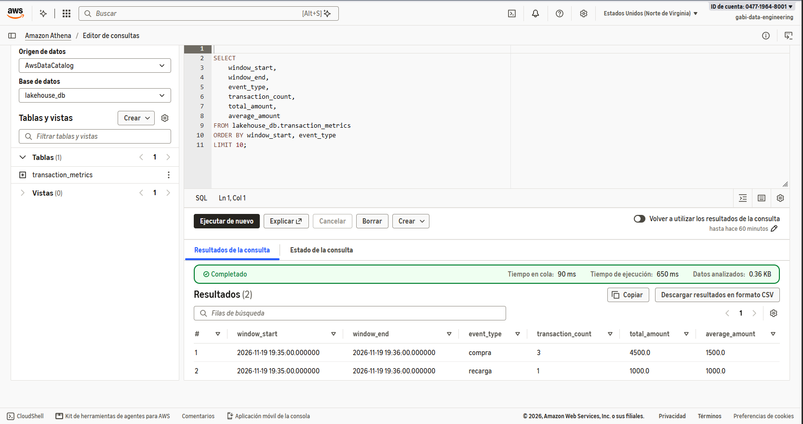

Se ejecutó `SELECT` sobre `AwsDataCatalog.lakehouse_db.transaction_metrics` en el workgroup `primary` y se recuperaron **dos filas agregadas**: `compra` (3 transacciones, total 4.500, promedio 1.500) y `recarga` (1 transacción, total 1.000, promedio 1.000). La consola informó **Completado**, **650 ms de ejecución** y **0,36 KB analizados**. Esto valida la lectura SQL de Iceberg desde Athena mediante el catálogo Glue, sin reiniciar Kinesis ni Flink.

```sql
SELECT
    window_start,
    window_end,
    event_type,
    transaction_count,
    total_amount,
    average_amount
FROM lakehouse_db.transaction_metrics
ORDER BY window_start, event_type
LIMIT 10;
```

El editor de Athena utilizó `s3://data-engineering-dev-047719648001/athena-results/pre05/` como ubicación de resultados. Los permisos se incorporaron mediante Terraform en `environments/dev/athena_query_iam.tf`, usando una **política IAM administrada** asociada al grupo `data-engineering-lab`: el intento inicial de crear una política *inline* adicional había superado el límite total de 5.120 caracteres de políticas inline del grupo. La solución final creó **2 recursos (política y asociación)** sin modificar ni eliminar otros recursos.

##### 10. Reconstrucción del ZIP desde un clon limpio

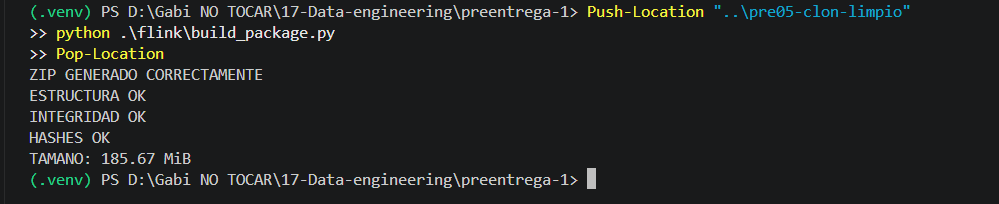

**Validación exitosa el 22/11/2026:** clon de `feature/lakehouse` en carpeta independiente, commit `1c36634`, JAR y ZIP iniciales ausentes, compilación Maven exitosa y reconstrucción del ZIP de **185,67 MiB** con estructura, integridad y hashes verificados. La receta y su alcance se documentan en «Prueba de reproducibilidad desde un clon limpio».

No se conserva una captura independiente del estado `RUNNING` de esta ejecución: se observó el estado por AWS CLI durante la prueba, pero no se documenta aquí como evidencia gráfica adicional.

#### Operación reproducible con Terraform y control de costos

La variable `enable_streaming`, definida en `environments/dev/streaming_control.tf`, tiene como valor predeterminado `false`. Por tanto, un plan normal del entorno DEV **no debe volver a crear** Kinesis o Flink. El código de ambos módulos se conserva para volver a ejecutar una prueba cuando se habiliten explícitamente.

Secuencia de referencia **solo para una nueva prueba autorizada** (desde `environments/dev`, luego de construir el ZIP y autenticar AWS):

```powershell
# El despliegue crea recursos facturables: revisar el plan antes de aplicar.
$env:TF_VAR_enable_streaming = "true"
terraform init
terraform validate
terraform --% plan -out=.terraform/pre05-streaming-on.tfplan
# Revisar los recursos del plan antes de continuar:
terraform show -no-color ".terraform/pre05-streaming-on.tfplan"
# Solo si la revisión es correcta:
terraform apply ".terraform/pre05-streaming-on.tfplan"

# Iniciar la aplicación desplegada sin restaurar un snapshot anterior.
aws kinesisanalyticsv2 start-application --application-name data-engineering-dev-flink --run-configuration "ApplicationRestoreConfiguration={ApplicationRestoreType=SKIP_RESTORE_FROM_SNAPSHOT}" --region us-east-1
```

Confirmar `RUNNING` antes de enviar eventos. Los eventos deben tener timestamps UTC recientes y ser posteriores al inicio cuando la fuente utiliza `LATEST`. El productor habitual requiere credenciales/perfil autorizado y, por defecto, envía 90 transacciones; **la prueba controlada de seis eventos del 19/11 fue un envío específico de laboratorio, no una ejecución de 90 eventos del productor habitual**.

Para retirar los componentes de la prueba, primero detener Managed Flink y verificar su estado `READY`. Guardar antes los registros CloudWatch que se quieran conservar. Después desactivar el streaming y generar **un plan normal** para que Terraform proponga retirar los recursos de esos módulos, revisándolo antes de aplicarlo:

```powershell
aws kinesisanalyticsv2 stop-application --application-name data-engineering-dev-flink --region us-east-1
# Verificar posteriormente que ApplicationStatus sea READY.
aws kinesisanalyticsv2 describe-application --application-name data-engineering-dev-flink --region us-east-1 --query "ApplicationDetail.ApplicationStatus" --output text

$env:TF_VAR_enable_streaming = "false"
terraform --% plan -out=.terraform/pre05-streaming-off.tfplan
terraform show -no-color ".terraform/pre05-streaming-off.tfplan"
# Aplicar solamente después de confirmar la lista de eliminaciones:
terraform apply ".terraform/pre05-streaming-off.tfplan"
```

En la ejecución documentada, antes de incorporar el interruptor, se revisó y aplicó un plan de limpieza selectiva de los módulos Flink y Kinesis: **13 recursos destruidos, 0 agregados y 0 modificados**. El control posterior mediante `terraform state list` confirmó que esos módulos ya no tenían recursos en el estado. El catálogo Glue, los datos Iceberg en S3 y la infraestructura base se conservaron. Posteriormente se publicó el **ZIP definitivo** en S3 con `0 added, 1 changed, 0 destroyed` y el plan final confirmó **`No changes`** con el streaming desactivado.

> **Costos y seguridad:** Kinesis provisionado y Managed Flink pueden generar cargos incluso con tráfico bajo. La limpieza de estos módulos no garantiza una cuenta sin costos: S3, logs, claves KMS administradas por el cliente u otros recursos conservados podrían facturar por separado. Revisar AWS Billing al concluir el proyecto. Mantener permisos IAM en Terraform, usar datos ficticios y no incorporar credenciales ni logs completos al repositorio.

#### Consideraciones, limitaciones y evolución

- **Resultado E2E:** se verificó una ventana con dos filas agregadas; no se ensayaron cargas elevadas ni múltiples días de operación.
- **Artefacto final:** el ZIP definitivo quedó compilado, verificado y publicado, pero no se volvió a ejecutar en AWS tras la consolidación del experimento. La ejecución AWS corresponde al paquete experimental corregido.
- **Watermarks y shards inactivos:** el conector Kinesis no aceptó la opción de inactividad que se había usado inicialmente; quedan pendientes pruebas específicas de particiones o shards inactivos y eventos tardíos.
- **Tolerancia a fallos:** se observaron commits vinculados a checkpoints, pero no se ensayó recuperación del job después de un fallo ni restauración desde snapshot.
- **Pruebas:** los 10 tests automatizados validan el productor y su esquema, pero no sustituyen una prueba E2E automatizada con infraestructura AWS desplegada.
- **Lectura en el experimento previo de compatibilidad AWS:** ese laboratorio Docker permitió escribir Iceberg; la lectura SQL con Flink en ese laboratorio presentó un error de deserialización de lambda y no se considera validada. La comprobación de los valores de ese experimento se realizó leyendo Parquet mediante PyArrow. El laboratorio JDBC de esta entrega se validó posteriormente mediante DuckDB, como se documenta en la primera parte de la sección.
- **Gobernanza:** conviene evolucionar hacia contratos de esquema versionados, validación de compatibilidad y controles de calidad de datos antes de uso productivo.
- **Escalabilidad:** se utilizó paralelismo 1 y una carga pequeña; no se midieron tasas sostenidas, límites del conector ni costes por volumen.
- **Repositorio y reproducibilidad:** los ZIP, artefactos Maven, cachés y respaldos experimentales se excluyen del control de versiones; `flink/application-pre05.zip` debe generarse antes del despliegue. Se verificó una reconstrucción desde un clon limpio de `feature/lakehouse` con el commit `1c36634`. La verificación no incluye repetir la ejecución AWS con ese ZIP.

#### Resultado de la variante AWS

Se implementó y verificó el recorrido **Python/Boto3 → Kinesis Data Streams → Managed Apache Flink → Apache Iceberg en S3 → Amazon Athena**, con **AWS Glue Data Catalog** como catálogo de la tabla. La prueba confirmó el procesamiento de eventos y la escritura de dos filas agregadas con cantidad, suma y promedio correctos, respaldadas por metadatos Iceberg con `append`, motor `flink` y checkpoint 22.

La consulta SQL de Athena también recuperó las dos filas esperadas. Las correcciones de compatibilidad se incorporaron al proyecto definitivo y se validaron localmente; el artefacto resultante quedó publicado en S3. Se **reconstruyó satisfactoriamente desde un clon limpio** de la rama `feature/lakehouse`, con validación de estructura, integridad y hashes. El entorno permanece con streaming desactivado por defecto, con su infraestructura de prueba eliminada y los datos analíticos preservados.

### Resultado de la Pre-entrega 05

El proyecto conserva dos variantes de persistencia Iceberg: el laboratorio local con JdbcCatalog sobre PostgreSQL y escritura explícita mediante IcebergSink Java, y la implementación AWS con Glue Data Catalog y PyFlink SQL. Ambas cuentan con pruebas funcionales documentadas de agregación y consulta. La ejecución local del 26/11/2026 verificó todos los componentes del recorrido con datos ficticios, sin volver a desplegar servicios en AWS.
